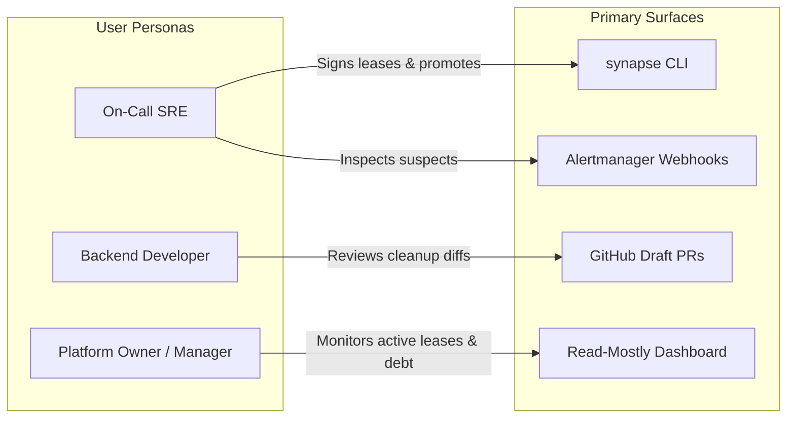

# SynapseState: Product Definition & Specification

> **Status:** Active Architecture Baseline (Post-Pivot)  
> **Primary Specification:** [docs/ARCHITECTURE.md](file:///c:/Users/adity/Desktop/Projects/SynapseState/docs/ARCHITECTURE.md)  
> **Roadmap:** [docs/ROADMAP.md](file:///c:/Users/adity/Desktop/Projects/SynapseState/docs/ROADMAP.md)  
> **Limitations:** [docs/limitations.md](file:///c:/Users/adity/Desktop/Projects/SynapseState/docs/limitations.md)

---

## 1. Executive Summary & One-Liner

**SynapseState** is a vendor-neutral **incident-safety and lifecycle governance layer for feature flags**, built natively on the [OpenFeature](https://openfeature.dev) standard.

It provides:
1. **Cryptographically signed, auto-expiring emergency overrides (break-glass leases)** that evaluate in-process and reconcile back to Git.
2. **Telemetry-driven, compiler-verified code retirement pull requests** that safely purge dead feature toggles from application repositories.
3. **Automated change attribution during incidents**, correlating SLO burn-rate alerts directly with recent flag changes to suggest actionable mitigation commands.

> [!IMPORTANT]
> **SynapseState does not replace your flag evaluator.** It sits directly on top of an existing OpenFeature provider (such as flagd in-process, Unleash, Flipt, or a plain JSON provider). SynapseState wraps the delegate provider in an `OverrideProvider` and instruments it with a `TelemetryHook`.

---

## 2. The Core Problems

Engineering teams operating feature flags in production Kubernetes environments face two acute operational dilemmas that conventional flag platforms do not solve:

### Problem 1: Emergency Changes Fight the Change Management Process
During an active P0 incident at 2 AM, an engineer must disable a failing code path immediately. Modern architectures force an unacceptable dilemma:
- **Uncontrolled SaaS/UI toggles:** An engineer clicks a button in a vendor web console. The change takes effect quickly, but it completely bypasses GitOps, leaving behind zero peer review, creating silent configuration drift, and often lingering forgotten in production for months.
- **Strict GitOps workflows:** Reverting the flag requires drafting a PR, waiting for automated CI checks, securing an on-call review, and waiting for deployment pipelines (3 to 15 minutes), while error budgets burn and customers suffer.

Neither approach delivers what reliability engineering actually requires: **instant, cryptographically attributable, time-bounded, and self-reverting overrides.**

### Problem 2: Dead Flags Accumulate as Permanent Technical Debt
Temporary release toggles rarely get deleted once a feature reaches 100% rollout. Months later, codebases are littered with obsolete conditionals, redundant branches, dead test mocks, and combinatorially explosive test matrices.

Determining whether a flag is truly dead across all production microservices is deceptively hard. Manually ripping them out is tedious, error-prone, and deprioritized by product teams. Automated tools (like Uber’s Piranha) require the flag name and desired outcome to be provided manually as input, rather than deducing staleness safely from production runtime telemetry.

### Secondary Gap: "What Changed?" During Incidents
When an alert fires, the first diagnostic question an on-call SRE asks is: *"What changed in the last 30 minutes?"* Flag updates are rarely correlated automatically with SLO alerts or Prometheus metrics, forcing engineers to manually cross-reference deployment logs, chat channels, and vendor dashboards.

---

## 3. Product Positioning & Value Proposition

| Dimension | Details |
|---|---|
| **Target Audience** | Backend platform, SRE, and microservice teams on Kubernetes using (or adopting) OpenFeature with GitOps practices. |
| **Critical Need** | A rapid, safe way to override flags during incidents, and an automated, reliable pipeline to retire dead flags afterward. |
| **What SynapseState Is** | A governance layer: signed break-glass leases, audit trails with external anchoring, privacy-preserving usage telemetry, and compiler-verified cleanup PRs. |
| **What SynapseState Is Not** | It is **not** a custom flag evaluation engine, not a targeting DSL, not a percentage-rollout system, and not a hosted SaaS platform. |
| **Key Differentiator** | Treats emergency overrides as time-boxed, cryptographically signed events that must reconcile to Git, and treats flag retirement as an evidence-driven, compiler-checked pipeline. |

---

## 4. User Personas & Primary Workflows



### Persona Matrix

| Persona | Operational Needs | Primary Surfaces |
|---|---|---|
| **On-Call SRE / Incident Responder** | Override or force a flag variant in under 30 seconds with guaranteed auto-expiry and non-repudiation. | `synapse-cli`, Alertmanager notifications |
| **Backend Microservice Developer** | Zero added evaluation latency, zero process crash hazards, and automated PRs that clean up dead flags safely. | OpenFeature SDK wrapper, GitHub Draft PRs |
| **Platform Owner / Lead Architect** | Unified visibility into active production overrides, audit compliance, and flag debt without vendor lock-in. | Next.js Dashboard, Grafana annotations |

---

## 5. Core Operational Workflows

### Workflow 1: Emergency Break-Glass Override (Flagship Flow)
1. **Incident Trigger:** An SLO burn-rate alert fires in Alertmanager. The notification lists the top suspect flag changes from the preceding 30 minutes.
2. **Signed Override Creation:** The on-call SRE issues an override:
   ```bash
   synapse lease create --flag checkout-v2 --env prod --value false --ttl 30m --reason "INC-142: High latency"
   ```
   The CLI signs the payload using the operator's local Ed25519 private key (stored in OS keychain or hardware token).
3. **Local Propagation & In-Process Enforcement:** Workload SDKs poll the Control API, verify the cryptographic signature against a locally pinned keyset from Git, establish dual-clock monotonic/wall expiry deadlines, and swap the override into active memory.
4. **Git Reconciliation (Promotion):** Before the 30-minute TTL expires, the operator promotes the override:
   ```bash
   synapse promote <lease_id>
   ```
   The Control API opens a GitHub Pull Request altering the flag definition in Git. **A peer review and merge of that PR serves as the secondary dual-control approval.**
5. **Deterministic Expiry:** If no promotion occurs, the lease expires locally. The SDK automatically reverts the flag to the Git-defined delegate value, emitting an informational alert to ensure human awareness.

### Workflow 2: Evidence-Driven Flag Retirement (`synapse-purger`)
1. **Zero-Context Telemetry:** The SDK `TelemetryHook` aggregates evaluations locally, flushing `(flag_key, variant, reason)` counts in periodic batches. No user IDs, context attributes, or targeting keys ever leave process memory.
2. **Staleness Qualification:** When a flag marked `release` evaluates to a single variant for $\ge 30\text{ days}$ (or has 0 evaluations), and **100% of registered services in the environment** have reported telemetry during that window, it is classified as a `stale_candidate`.
3. **Compiler-Verified Refactoring:** `synapse-purger` analyzes the application repository using `ts-morph`:
   - Replaces literal-key flag checks (`getBooleanValue('k', ...)`) with the winning boolean branch.
   - Eliminates dead conditional branches, obsolete variables, and unused imports.
   - Executes pre-flight verification: `tsc --noEmit`, ESLint, and repository test suites.
4. **Draft PR Submission:** The purger opens a Draft PR containing diff summaries, test verification logs, and attached telemetry proofs.
5. **Refusal by Default:** If dynamic keys, complex wrappers, or test mocks are encountered, the purger refuses to modify code and emits a structured **refusal report**.

### Workflow 3: Incident Change Attribution ("What Changed?")
1. Alertmanager emits a webhook to `POST /v1/alerts/webhook` upon an SLO violation.
2. The Control API queries change events from the past 30 minutes (leases, revocations, promotions, Git config merges).
3. It ranks suspects based on recency and service evaluation overlap.
4. It annotates Grafana dashboards and posts the suspect list to the incident channel, including a ready-to-run, copy-pasteable `synapse lease create` command. (Nothing is executed automatically; humans maintain full command authority).

### Workflow 4: Cryptographic Audit Verification
Every administrative transition is recorded in an append-only, SHA-256 hash-chained PostgreSQL ledger. Scheduled background jobs sign periodic state checkpoints to an external write-once store (e.g., Git branch or object-locked S3). Anyone can audit the system via:
```bash
synapse audit verify
```
This recomputes the hash chain from genesis and validates it against external checkpoints.

---

## 6. System Scope & Phased Boundaries

### MVP Scope (Phases 1 to 4)
- **`packages/lease`:** Canonicalization (RFC 8785), Ed25519 signing, verification, and dual-clock expiry.
- **`packages/sdk`:** Pure TypeScript OpenFeature `OverrideProvider` and `TelemetryHook` with HTTP polling (`ETag`).
- **`packages/cli`:** SRE tool for lease creation, revocation, listing, promotion, and audit verification.
- **`apps/control-api`:** Node.js + Postgres service managing lease lifecycle, telemetry rollups, Git integration, and audit chain.
- **Git Reconciliation:** Automated PR opening upon promotion; merge webhooks for final lease finalization.
- **Demo Application:** Fully instrumented demo service for fault-injection drills and load testing.
- **Full Production Pipeline:** GitHub Actions CI/CD, multi-stage Docker builds, Terraform IaC, k3s Helm charts, Prometheus/Grafana observability, and published SLOs.

### Expanded Scope (Phases 5 to 6)
- **`apps/purger`:** AST refactoring engine for literal TypeScript flag patterns with structured refusal reports.
- **`apps/dashboard`:** Read-mostly Next.js operations portal with OIDC RBAC.
- **Incident Attribution Engine:** Webhook ingestion correlating alerts with flag change events.

### Explicit Non-Goals
1. **No Custom Evaluator or Targeting DSL:** We do not build rule evaluation, segment matching, or MurmurHash percentage rollouts. Evaluation is completely delegated to standard OpenFeature providers.
2. **No Client-Side or Mobile SDKs:** SynapseState is built strictly for server-side Kubernetes workloads. Internal business logic and keysets never leave trusted infrastructure.
3. **No Web-Based Configuration Authoring:** SynapseState does not provide a UI for editing flag definitions. Git is the sole source of truth for baseline configurations.
4. **No Autonomous Code Merging:** Automated tooling only opens Draft PRs. Human review is mandatory.
5. **No Per-Evaluation Network Hops:** SDKs evaluate strictly from in-process memory. Overrides and telemetry are decoupled from the hot path.
6. **No Microbenchmark Theater:** We do not claim arbitrary nanosecond records. We publish only measured wrapper overhead compared against bare delegate providers.

---

## 7. Competitive Differentiation (Stated Honestly)

| Capability | flagd / OpenFeature Operator | Unleash (Self-Hosted OSS) | Uber Piranha | SynapseState |
|---|---|---|---|---|
| **Local In-Process Evaluation** | Yes (in-process mode with gRPC sync) | Yes (local evaluation SDKs) | N/A | **Delegated to existing OpenFeature provider** |
| **Signed, Expiring Overrides in SDK** | Not supported | Not supported | N/A | **Core Feature** (Ed25519 + dual-clock expiry) |
| **Git Reconciliation of Overrides** | Not supported | Not supported | N/A | **Core Feature** (PR promotion flow) |
| **Telemetry-Driven Stale Detection** | No | Usage metrics exist; staleness is manual | No (requires manual flag list as input) | **Core Feature** (Coverage-verified candidate rule) |
| **Automated Code Removal** | No | No | **Yes (Multi-language, production-proven)** | Narrow TypeScript subset with refusal-by-default |
| **Sync Protocol Authentication** | Unauthenticated sync in baseline specs | Token-based API access | N/A | **Cryptographically signed payload envelopes** |

---

## 8. Success Metrics & Reliability Targets

All targets represent engineering hypotheses to be measured, validated, and published:

| Target Metric | Objective | Verification Method |
|---|---|---|
| **Lease Propagation Lag** | $p95 \le 10\text{ s}$ under 5s polling | Calculated using server timestamps (`server_time - issued_at`) under k6 load. |
| **Lease Expiry Correctness** | **Zero** leases honored past `TTL + SKEW_TOLERANCE` | Continuous property testing (`fast-check`) and chaos clock-skew injection. |
| **SDK Evaluation Overhead** | Minimal added overhead vs bare delegate | Microbenchmarks and macro benchmarks measuring `OverrideProvider` lookup. |
| **Evaluation Path Availability** | 100% (Zero failures caused by SynapseState) | Injected SDK network, serialization, and control-plane failure drills. |
| **Control API Availability** | 99.5% over 30 days (Single node) | Prometheus SLI. (Workload SDKs fail-static during API downtime). |
| **Purger Precision** | 0 incorrect removals on labeled corpus | Test suite executing across supported, complex, and adversarial test cases. |

---

## 9. Claims Policy & Engineering Ethics

To maintain strict technical integrity across documentation and public repositories:
- **Evidence Before Claims:** Only publish numbers that have been directly measured under documented hardware and test environments.
- **Zero Buzzwords:** Prohibit ungrounded marketing claims ("lock-free", "bank-grade", "50,000x faster", "military-grade").
- **Accurate Scope:** Clearly disclose that SynapseState is an incident and lifecycle governance layer, not a replacement for OpenFeature providers.
- **Transparent Limitations:** Maintain an authoritative [docs/limitations.md](file:///c:/Users/adity/Desktop/Projects/SynapseState/docs/limitations.md) document listing all known architectural boundaries and failure modes.
