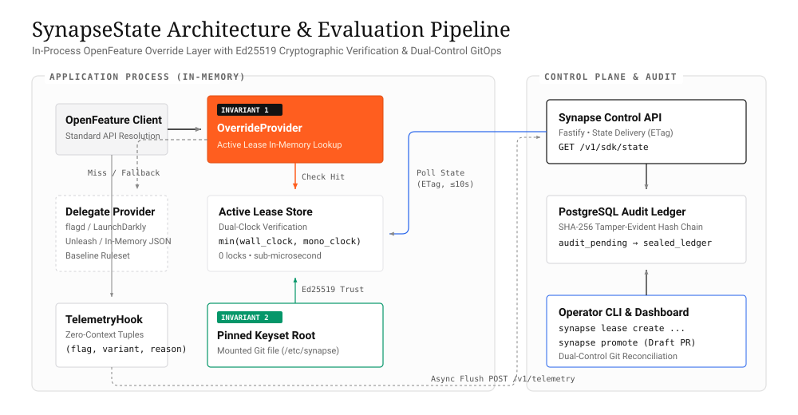
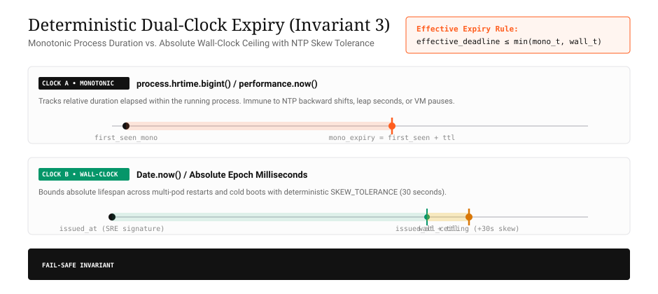
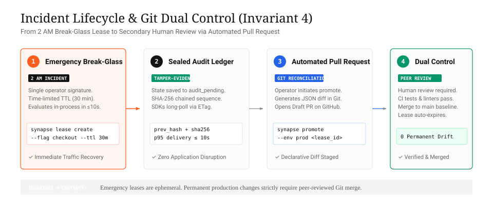
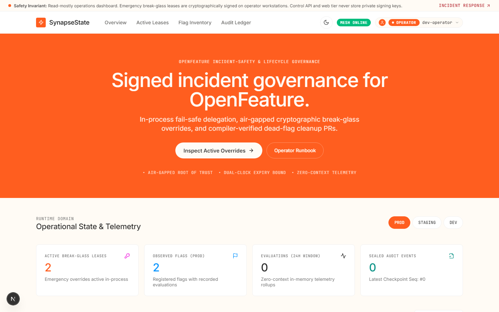
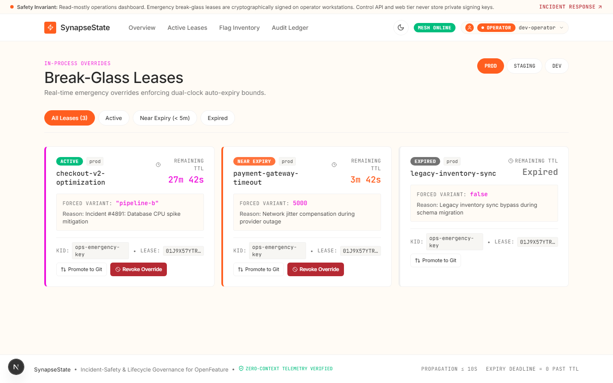
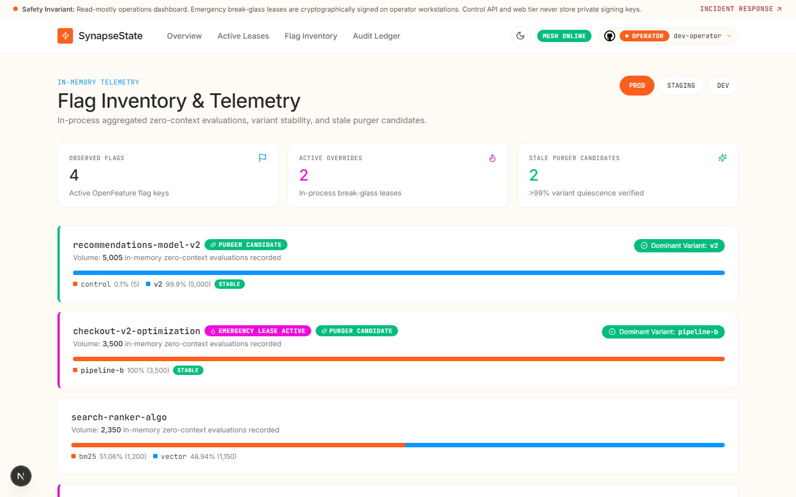
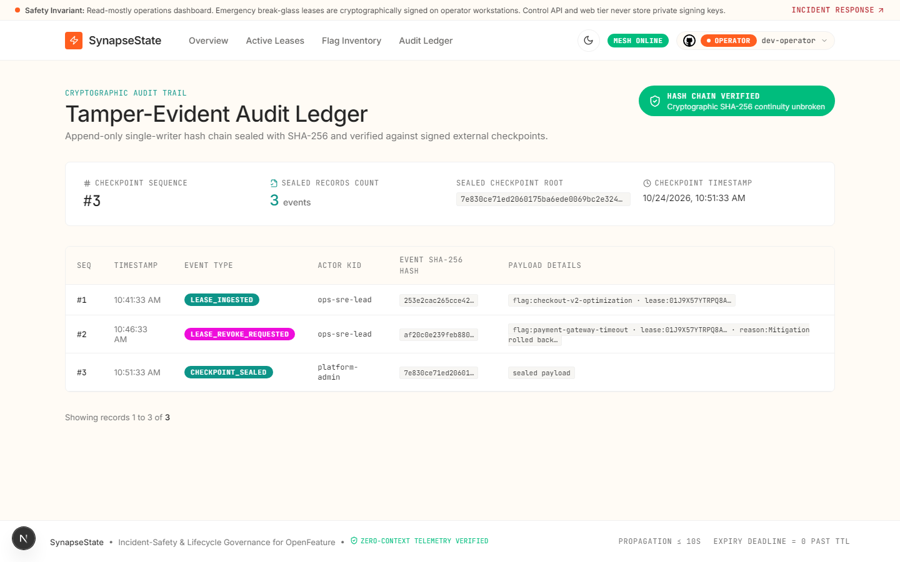
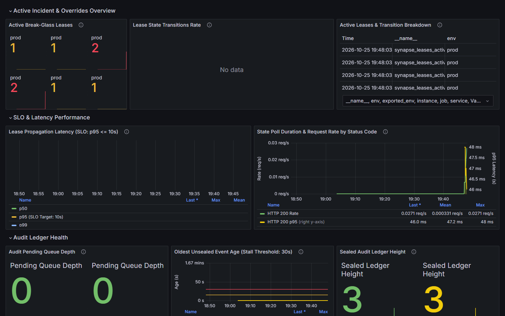

# SynapseState

> **Incident-Safety & Lifecycle Governance Layer for OpenFeature**  
> Signed, auto-expiring emergency overrides that evaluate in-process and reconcile back to Git — coupled with telemetry-driven, compiler-verified cleanup pull requests for dead feature flags.

[](https://opensource.org/licenses/MIT)
[](https://www.typescriptlang.org/)
[](https://openfeature.dev/)
[](docs/benchmarks/sdk-overhead.md)
[](docs/benchmarks/load-test-report.md)

---

## 1. System Architecture

SynapseState does **not** evaluate flags or manage rollouts. It wraps existing OpenFeature providers (such as `flagd` in-process, JSON files, or Unleash) in-memory. During incidents, authorized operators issue cryptographically signed, short-lived emergency overrides that take effect across all application instances in seconds without redeploying code.



### How Evaluation Works
1. **Application Resolution:** The application requests a flag value via the standard OpenFeature client.
2. **In-Process Cache Check:** SynapseState's `OverrideProvider` checks its in-memory map of active leases.
3. **Emergency Override (Hit):** If a valid, non-expired emergency lease exists, it immediately returns the overridden value (resolving in ~2.16 µs).
4. **Fail-Safe Fallback (Miss):** If no lease exists or an internal error occurs, it falls back instantly to the delegate OpenFeature provider (adding only ~99 ns overhead).

---

## 2. Core Architectural Pillars

### Pillar A: Deterministic Dual-Clock Expiry (Invariant 3)
Emergency overrides are strictly bound by two clocks evaluated simultaneously in-process:
- **Monotonic Relative Clock:** Evaluates duration elapsed since arrival (`first_seen_mono + ttl_seconds`), completely immune to NTP steps, VM clock smearing, or host clock adjustments.
- **Wall-Clock Ceiling:** Evaluates absolute epoch time (`issued_at + ttl_seconds + SKEW_TOLERANCE`), ensuring multi-pod cold boots or restarts cannot resurrect expired leases.
- Overrides are honored for $\le \min(\text{wall\_expiry}, \text{mono\_expiry})$. **Zero leases can survive past their deadline.**



---

### Pillar B: Incident Lifecycle & Git Dual Control (Invariant 4)
The 2 AM incident path requires only a single operator signature to mitigate outages immediately. Making an override permanent requires promoting it to Git, where human peer review serves as the mandatory secondary control.



1. **Break-Glass Override:** SRE creates a signed lease via CLI (`synapse lease create`) or Operations Portal.
2. **In-Process Ingestion:** Control API stages the event to `audit_pending`, seals it into a SHA-256 chained PostgreSQL ledger, and SDKs ingest it via ETag long-polling in $\le 10$ seconds.
3. **Git Promotion:** Operator runs `synapse promote <lease_id>`. Control API generates declarative flag updates and opens a Draft Pull Request on GitHub.
4. **Mandatory Secondary Control:** Peer engineers review the PR diff, CI tests pass, and upon merge to `main`, the baseline provider adopts the value and the emergency lease cleanly retires.

---

## 3. Operations Dashboard

SynapseState includes an operations dashboard built with Next.js, implementing a minimalist, high-contrast **Voltage** design system (solid hairlines, binary radius scale, zero decorative drop-shadows).

### 3.1 Overview & System Telemetry
The command-center overview surfaces live active lease counts, candidate dead-flags, audit verification status, and quick CLI execution snippets.



---

### 3.2 Active Emergency Leases
Real-time inspection of active break-glass leases across environments (`prod`, `staging`, `dev`), featuring live dual-clock countdown timers and single-click revocation and Git promotion workflows.



---

### 3.3 Flag Inventory & Candidate Qualification
Telemetry-driven flag tracking displaying 30-day evaluation counts, variant distribution rollups, and automated retirement qualification status for `synapse-purger`.



---

### 3.4 Cryptographic Audit Ledger
Tamper-evident SHA-256 hash-chained audit record inspection, displaying cryptographic sequence numbers, signatures, and periodic state checkpoints.



---

### 3.5 SRE Grafana Operations Dashboard
Pre-configured production operations dashboard visualizing live override states, $p50/p95/p99$ lease propagation latencies against the 10s SLO, SHA-256 ledger heights, and SDK fleet health.



---

## 4. The 8 Non-Negotiable Invariants

All components in the monorepo strictly enforce these architectural invariants:

| # | Invariant | System Guarantee |
|:---:|---|---|
| **1** | **Fail-Safe Hot Path Delegation** | Resolution occurs 100% in-memory. If no lease exists or an internal exception occurs, evaluation falls back immediately to the delegate provider. |
| **2** | **Pinned Keyset Trust Root** | SDKs verify Ed25519 signatures against a locally pinned keyset file mounted from Git (`/etc/synapse`). The Control API never serves keys. |
| **3** | **Deterministic Dual-Clock Expiry** | Leases enforce $\le \min(\text{wall\_expiry}, \text{mono\_expiry})$. Clock skew and NTP jumps cannot extend lease lifespans. |
| **4** | **Git Reconciliation as Dual Control** | 2 AM break-glass overrides require one signature; making an override permanent strictly requires a merged GitHub PR. |
| **5** | **Zero-Context Telemetry** | SDK telemetry hooks capture only `(flag_key, variant, reason)` tuples and counts. Zero user attributes or targeting contexts ever egress. |
| **6** | **Read-Only Codebase Scanner** | `synapse-purger` operates as a read-only AST scanner. It never executes target repository test suites or build scripts. |
| **7** | **Tamper-Evident Audit Ledger** | Mutations stage to `audit_pending` and seal asynchronously to a SHA-256 hash-chained PostgreSQL ledger. |
| **8** | **Ecosystem & Library-First Reuse** | Always prioritize native runtime APIs (`node:crypto`) and standard ecosystem libraries before writing custom code. |

---

## 5. Quickstart

### 5.1 Installation & Setup
```bash
# Clone and install dependencies
git clone https://github.com/adityapawar112/SynapseState.git
cd SynapseState
pnpm install

# Start local PostgreSQL database
docker compose up -d postgres

# Optional: Start Prometheus & Grafana with pre-provisioned SynapseState dashboard
docker compose -f docker-compose.observability.yml up -d
# -> Grafana available at http://localhost:3002 (pre-configured with Prometheus and SynapseState dashboard)

# Build all monorepo packages
pnpm run build

# Run test suite
pnpm test
```

### 5.2 OpenFeature SDK Integration
Wrap your existing OpenFeature provider with SynapseState:

```typescript
import { OpenFeature } from "@openfeature/server-sdk";
import { OverrideProvider, TelemetryHook, FileKeysetProvider } from "@synapsestate/sdk";
import { InMemoryProvider } from "@openfeature/server-sdk"; // or flagd, LaunchDarkly, etc.

// 1. Initialize your baseline OpenFeature provider
const baselineProvider = new InMemoryProvider({
  "checkout-v2": {
    disabled: false,
    variants: { on: true, off: false },
    defaultVariant: "off"
  }
});

// 2. Wrap provider with SynapseState OverrideProvider
const keysetProvider = new FileKeysetProvider("/etc/synapse/keyset.json");
const overrideProvider = new OverrideProvider({
  delegate: baselineProvider,
  controlApiUrl: "https://synapse.internal:3000",
  keysetProvider,
  pollIntervalMs: 5000,
});

// 3. Register with OpenFeature and attach Zero-Context Telemetry
await OpenFeature.setProviderAndWait(overrideProvider);
OpenFeature.addHooks(new TelemetryHook({
  controlApiUrl: "https://synapse.internal:3000",
  flushIntervalMs: 10000,
}));

// 4. Standard evaluation — evaluates in-memory in nanoseconds!
const client = OpenFeature.getClient();
const isEnabled = await client.getBooleanValue("checkout-v2", false);
```

### 5.3 Operator CLI Usage (`synapse`)
```bash
# Generate Ed25519 signing keypair
synapse key generate --out-pub keyset.json --out-priv operator.key

# Create emergency 30-minute override
synapse lease create \
  --flag checkout-v2 \
  --env prod \
  --value true \
  --ttl 30m \
  --reason "Incident INC-8492: payment provider gateway degradation" \
  --key operator.key

# List active leases
synapse lease list --env prod

# Promote lease to Git (opens GitHub Draft Pull Request)
synapse promote <lease-id> --env prod

# Early emergency revocation
synapse lease revoke <lease-id> --env prod --key operator.key
```

---

## 6. Monorepo Structure

```
.
├── apps/
│   ├── control-api/        # Fastify + PostgreSQL governance & state delivery service
│   ├── dashboard/          # Next.js operations portal with GitHub OAuth & RBAC
│   ├── demo-shop/          # Example microservice app for verification & chaos injection
│   └── purger/             # Read-only TypeScript AST dead-flag qualifier (ts-morph)
├── packages/
│   ├── lease/              # Canonicalization (RFC 8785), Ed25519 signing & verification
│   ├── sdk/                # Pure TypeScript OpenFeature OverrideProvider & TelemetryHook
│   ├── cli/                # SRE command-line tool (synapse)
│   └── conformance/        # Language-neutral test vectors (JSON) & test runner
├── deploy/
│   ├── terraform/          # VM, networking, firewall, and cloud infra
│   └── helm/               # Helm charts for Control API, Postgres, Observability
├── docs/                   # Authoritative system specs, ADRs, runbooks, and benchmarks
└── load/                   # k6 load-testing & saturation scripts
```

---

## 7. Performance & Reliability SLOs

All state delivery and evaluation paths are validated against continuous benchmarks:

| Measurement Boundary | Target SLO | Measured Empirical Value | Reference |
|---|---|---|---|
| **Lease Propagation Lag** | $p95 \le 10\text{ s}$ | **$p95 = 0.462\text{ s}$** | [docs/benchmarks/load-test-report.md](docs/benchmarks/load-test-report.md) |
| **SDK Hot-Path Miss Overhead** | Minimal vs bare delegate | **$99.0\text{ ns} \pm 0.54\%$** | [docs/benchmarks/sdk-overhead.md](docs/benchmarks/sdk-overhead.md) |
| **SDK Hot-Path Override Hit** | Sub-microsecond execution | **$2.16\text{ \mu s} - 3.06\text{ \mu s}$** | [docs/benchmarks/sdk-overhead.md](docs/benchmarks/sdk-overhead.md) |
| **Lease Expiry Correctness** | **0** past $\text{TTL} + \text{SKEW}$ | **0 violations** | [test/drills/drill2-clock-skew.test.ts](test/drills/drill2-clock-skew.test.ts) |
| **Evaluation Path Availability** | 100% (Zero app crashes) | **100%** (Automatic fallback) | [packages/sdk/src/provider.test.ts](packages/sdk/src/provider.test.ts) |
| **Purger Refactoring Precision** | 0 incorrect removals | **0 false qualifications** | [apps/purger/src/qualification/engine.test.ts](apps/purger/src/qualification/engine.test.ts) |
| **Mutation Resilience (MSI)** | $\text{MSI} \ge 80\%$ | **83.94%** (`lease`) / **87.46%** (`sdk`) | [packages/lease/stryker.config.json](packages/lease/stryker.config.json) |
| **Chaos Failure Drills** | 100% pass (3/3 drills) | **14/14 passed** (Airgap, Skew, Partitions) | [test/drills/run-drills.sh](test/drills/run-drills.sh) |

---

## 8. Documentation Index

- [docs/ARCHITECTURE.md](docs/ARCHITECTURE.md) — Authoritative system architecture and module specifications
- [PRODUCT.md](PRODUCT.md) — Product requirements, operational personas, and Zero-Buzzwords policy
- [AGENTS.md](AGENTS.md) — Engineering charter, non-negotiable invariants, and development rules
- [CONTRIBUTING.md](CONTRIBUTING.md) — Developer setup, monorepo workflows, and testing instructions
- [docs/limitations.md](docs/limitations.md) — Documented system boundaries, fail-modes, and trade-offs
- [docs/benchmarks/sdk-overhead.md](docs/benchmarks/sdk-overhead.md) — Microbenchmarks measuring wrapper overhead
- [docs/handoff-phase8-pr30-31-load-testing-and-observability.md](docs/handoff-phase8-pr30-31-load-testing-and-observability.md) — Phase 8 handoff for k6 soak suites and containerized dashboard capture (PRs 30–31)
- [docs/runbooks/propagation-latency.md](docs/runbooks/propagation-latency.md) — Incident runbook for lease propagation degradation
- [docs/adr/](docs/adr/) — Architectural Decision Records

---

## 9. License

MIT © [SynapseState Contributors](LICENSE)
