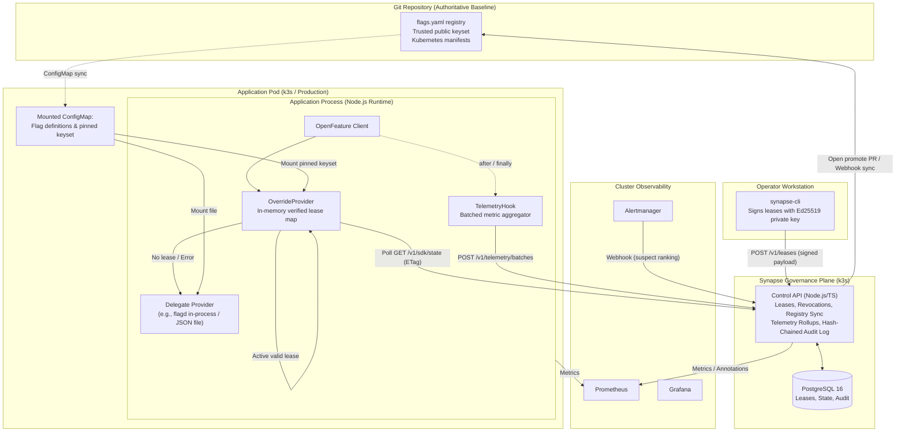
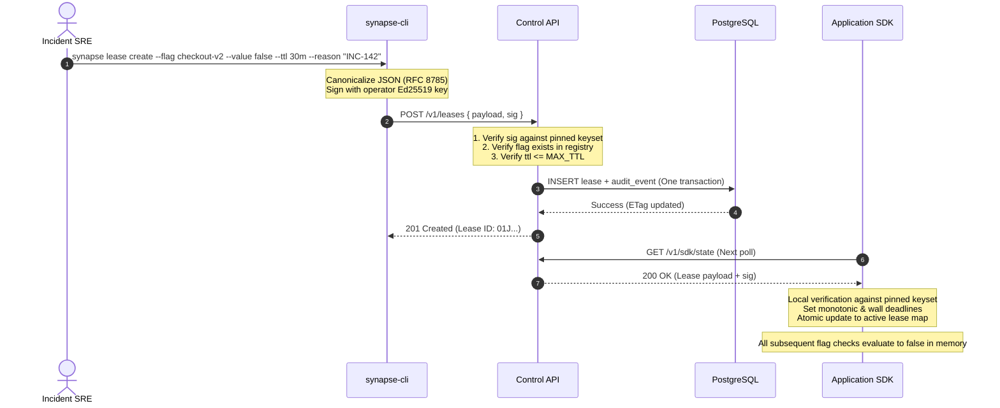
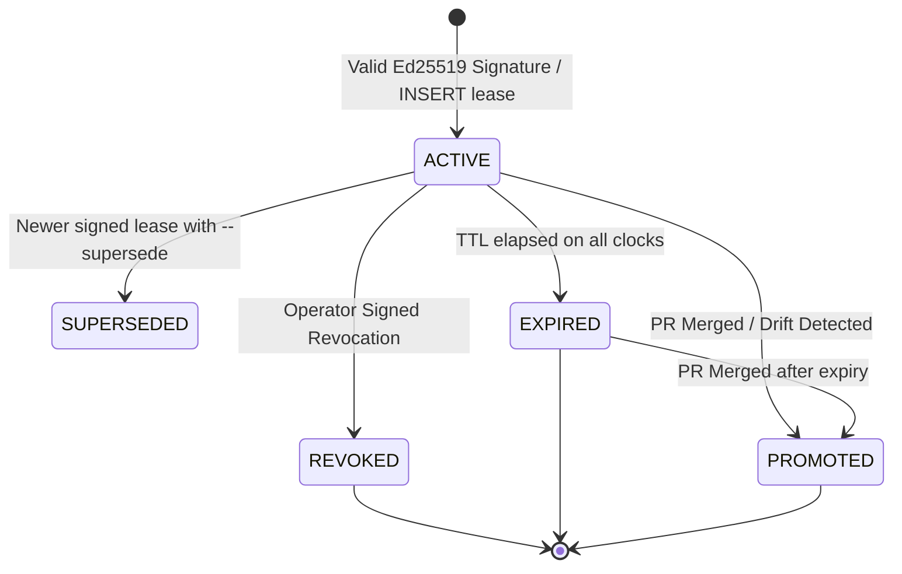
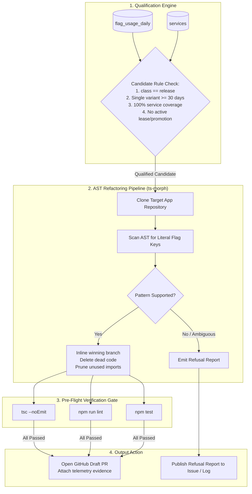

# SynapseState: System Architecture Specification

> **Status:** Active Engineering Baseline  
> **Classification:** Cloud-Native Incident-Safety & Lifecycle Layer for OpenFeature  
> **Companion Document:** [PRODUCT.md](file:///c:/Users/adity/Desktop/Projects/SynapseState/PRODUCT.md)  
> **Roadmap:** [docs/ROADMAP.md](file:///c:/Users/adity/Desktop/Projects/SynapseState/docs/ROADMAP.md)  
> **Limitations:** [docs/limitations.md](file:///c:/Users/adity/Desktop/Projects/SynapseState/docs/limitations.md)

---

## 1. Architectural Philosophy, Goals & Constraints

SynapseState provides an incident-safety, governance, and automated lifecycle layer on top of standard [OpenFeature](https://openfeature.dev) providers. Rather than re-implementing flag evaluation engines, targeting languages, or percentage rollout algorithms, SynapseState augments existing providers with cryptographic emergency overrides, GitOps reconciliation, and compiler-verified code retirement.

```
                           ┌──────────────────────────────────────────────┐
                           │               SynapseState                   │
                           │   Incident Safety & Governance Layer        │
                           └──────────────┬───────────────────────────────┘
                                          │ wraps & delegates
                                          ▼
                           ┌──────────────────────────────────────────────┐
                           │          OpenFeature Provider                │
                           │  (flagd in-process, Unleash, Flipt, JSON)    │
                           └──────────────────────────────────────────────┘
```

### Core System Goals
1. **In-Process Signed Overrides:** Emergency break-glass leases signed with Ed25519, enforced locally inside application process memory, and guaranteed to fail static if the control plane is partitioned or offline.
2. **Deterministic Auto-Expiry:** Rigorous dual-clock bounds (monotonic elapsed time since first observation combined with wall-clock absolute deadlines) guaranteeing that no override outlives its lease.
3. **Automated Git Reconciliation:** Break-glass overrides reconcile back into the authoritative Git repository via automated Pull Requests, where human code review serves as the second approval.
4. **Context-Free Stale Detection:** Aggregate runtime evaluation telemetry to identify dead release toggles without ever logging or egressing evaluation context, user attributes, or targeting keys.
5. **Compiler-Verified Code Retirement:** Automated refactoring (`synapse-purger`) that safely purges stale flags from application codebases, verified by compiler checks, linters, and repository tests, with strict refusal-by-default for ambiguous syntax.
6. **Incident Change Attribution:** Automated correlation between Alertmanager SLO alerts and recent flag changes, providing on-call engineers with ranked suspects and copy-pasteable mitigation commands.

### Engineering Constraints
- **Single Developer / Small Team Execution:** Entire codebase implemented in TypeScript/Node.js, allowing focus on infrastructure, reliability, and security practices rather than cross-compilation overhead.
- **Cost-Effective Infrastructure:** Designed to run on a single lightweight virtual machine running k3s, with automated teardown and recreation via Terraform.
- **Fail-Safe Hot Path:** SynapseState must never disrupt or block application flag evaluation. Any internal SDK error fails open by falling back directly to the delegate OpenFeature provider.

---

## 2. High-Level System Context & Topology



---

## 3. Monorepo Component Architecture

```
synapsestate/
├── apps/
│   ├── control-api/        # Node.js + Postgres governance service (HTTP API)
│   ├── dashboard/          # Read-mostly Next.js operations portal with OIDC RBAC
│   ├── demo-shop/          # Realistic microservice app using SDK (fault-injection target)
│   └── purger/             # TypeScript AST refactoring worker (ts-morph)
├── packages/
│   ├── lease/              # Shared cryptographic core: RFC 8785, Ed25519, verification
│   ├── sdk/                # Pure TypeScript OpenFeature OverrideProvider & TelemetryHook
│   ├── cli/                # SRE command-line tool (synapse)
│   └── conformance/        # Language-neutral test vectors (JSON) and test runner
├── deploy/
│   ├── terraform/          # Cloud VM, networking, firewall, DNS, object storage
│   ├── helm/               # Helm charts for Control API, Postgres, Observability
│   └── gitops/             # GitOps deployment manifests (Phase 7)
├── load/                   # k6 load-testing suites for state polling and telemetry
└── docs/
    ├── ARCHITECTURE.md     # This authoritative specification
    ├── ROADMAP.md          # Phased delivery roadmap & kill criteria
    ├── limitations.md      # Documented system boundaries and failure modes
    ├── adr/                # Architectural Decision Records
    ├── runbooks/           # Operator disaster recovery and incident runbooks
    └── postmortems/        # Failure injection reports and retrospectives
```

### The In-Process SDK Architecture: Wrapper Provider & Hook
OpenFeature’s architecture cleanly accommodates SynapseState through two native extension points:

1. **`OverrideProvider`:** Implements the OpenFeature `Provider` interface. It maintains an in-memory map of currently active, cryptographically verified leases. Upon evaluation:
   - It checks whether an active, valid lease exists for the requested `flagKey`.
   - If present and valid, it returns the lease value immediately, setting resolution metadata:
     `reason = "OVERRIDE"`, `metadata = { leaseId: "01J...", issuedBy: "sre-alice" }`.
   - If no lease exists, or if the lease has expired, it delegates directly to the underlying **`DelegateProvider`** (e.g., `flagd` reading a local JSON ConfigMap).
   - If an internal exception occurs inside the wrapper, it catches the error, increments an error counter, and falls through to the delegate provider.
2. **`TelemetryHook`:** Implements OpenFeature `after` and `finally` lifecycle hooks. It records evaluation outcomes `(flag_key, variant, reason)` in an in-memory ring buffer. It **never inspects or accesses evaluation context**, guaranteeing zero privacy leakage.

---

## 4. System Data Flows & Protocols

### 4.1 State Delivery Protocol (Control Plane to SDK)
State synchronization uses standard HTTP polling with `ETag` conditional caching:

```
Application SDK                                   Control API
      │                                                │
      │─── GET /v1/sdk/state?env=prod ────────────────►│
      │    If-None-Match: "33a64df5"                   │
      │    Authorization: Bearer <service_token>       │
      │                                                │
      │◄── 304 Not Modified ───────────────────────────│ (No change, zero allocation)
      │    (wait 5s + jitter)                          │
      │                                                │
      │─── GET /v1/sdk/state?env=prod ────────────────►│
      │    If-None-Match: "33a64df5"                   │
      │                                                │
      │◄── 200 OK (ETag: "7c91e2b8") ──────────────────│
      │    { server_time, active_leases, revocations } │
      ▼                                                ▼
```

- **Poll Interval:** Default 5 seconds with random jitter.
- **Payload Contents:**
  - `server_time`: Authoritative server timestamp (used for propagation lag calculation).
  - `active_leases`: Array of cryptographically signed lease envelopes.
  - `revocations`: Array of signed lease revocation records issued after the SDK's watermark.
  - `registry_version`: Current version sequence of the flag catalog.
- **Authentication:** Service-scoped bearer tokens, stored hashed (SHA-256) server-side and rotatable.
- **Separation of Concerns:** Flag definitions themselves (targeting rules, variants) do **not** flow through this API; they are managed by the delegate provider's native mechanism (e.g. Kubernetes ConfigMap).

### 4.2 Emergency Lease Creation Flow


### 4.3 Git Reconciliation & Promotion Flow
```
synapse promote <lease_id>
       │
       ▼
Control API (via GitHub App) opens Pull Request:
  - Branch: synapse/promote-lease-01J...
  - Changes: Update flags.yaml (baseline flag definition)
  - Description: Links incident reason, lease ID, and operator signature
       │
       ▼
GitHub CODEOWNERS & Branch Protection:
  - Requires independent peer review and approval
  - Human review acts as the formal second approval (Dual-Control)
       │
       ▼
PR Merged into default branch
       │
       ▼
GitHub Webhook triggers Control API:
  - State moves to PROMOTED
  - Generates signed revocation for the temporary lease
  - Appends audit event linking merge commit SHA
```

### 4.4 Telemetry Collection Flow
1. **In-Memory Buffering:** The `TelemetryHook` increments counters in a local hash map keyed by `(flag_key, variant, reason)`.
2. **Periodic Flushing:** Every 60 seconds (configurable), the worker flushes the aggregate batch to `POST /v1/telemetry/batches`.
3. **Idempotency:** Batches carry `{ instance_id, batch_id, window_start, window_end, metrics: [...] }`. The combination of `(instance_id, batch_id)` has a unique index in PostgreSQL, making retries safe.
4. **Non-Blocking Guarantee:** The buffer has a fixed capacity (default 10,000 tuples). If saturated, older metrics are dropped and a `dropped_total` counter is incremented. The telemetry path never blocks application threads and never throws exceptions.
5. **Propagation Lag Measurement:** When an SDK first observes and verifies a new lease, it reports:
   $$\text{propagation\_lag\_ms} = \text{server\_time}_{\text{poll\_response}} - \text{lease.issued\_at}$$
   Both timestamps originate from the Control API server clock, eliminating client clock skew from propagation metrics.

---

## 5. Cryptographic Lease Specification & Verification

### 5.1 Canonical Payload Schema (RFC 8785)
All emergency leases are constructed as deterministic JSON objects canonicalized under **RFC 8785** before signing:

```json
{
  "v": 1,
  "lease_id": "01J9X57YTRPQ8A7F4E12345678",
  "env": "prod",
  "flag_key": "checkout-v2",
  "value": false,
  "reason": "INC-142: Database connection pool exhaustion",
  "issued_at": "2026-10-06T02:14:00.000Z",
  "ttl_seconds": 1800,
  "kid": "sre-alice-2026-01",
  "nonce": "NzkxZDJiODRhYTgz..."
}
```

- **Domain Separation:** Before signing, a prefix byte string (`"synapsestate/lease/v1\n"`) is prepended to the canonical payload bytes. This guarantees that signatures cannot be transplanted across protocol message types.
- **Revocation Message Schema:** Revocations use domain prefix `"synapsestate/revocation/v1\n"` over canonical payload:
  `{ "v": 1, "lease_id": "...", "revoked_at": "...", "kid": "...", "reason": "..." }`.

### 5.2 Trust Root Architecture (The Pinned Keyset)
To protect against control-plane compromise:
- **No Keyset Distribution via Control API:** The Control API does **not** serve or manage the public keyset used by workload SDKs.
- **Git-Managed Keyset:** The trusted keyset (`kid -> { publicKey, role, status }`) is committed to Git and mounted into workload pods as a Kubernetes ConfigMap file.
- **Zero Forgery Under Compromise:** If an attacker gains full administrative access to the Control API and PostgreSQL, they **cannot forge emergency overrides**, because application SDKs verify signatures strictly against their locally mounted, Git-audited keyset.

### 5.3 SDK Dual-Clock Verification Algorithm
To protect against both NTP clock tampering and replay attacks, SDKs enforce dual-clock bounds:

```python
def verify_lease(envelope, pinned_keyset, now_wall, now_mono):
    # 1. Schema and Identity Check
    if envelope.v != 1: return REJECT_UNSUPPORTED_VERSION
    key_entry = pinned_keyset.get(envelope.payload.kid)
    if not key_entry or key_entry.status != "ACTIVE": return REJECT_UNKNOWN_KEY
    if "lease_signer" not in key_entry.roles: return REJECT_UNAUTHORIZED_ROLE

    # 2. Cryptographic Verification
    canonical_bytes = rfc8785_canonicalize(envelope.payload)
    message = "synapsestate/lease/v1\n" + canonical_bytes
    if not ed25519_verify(key_entry.public_key, message, envelope.sig):
        return REJECT_INVALID_SIGNATURE

    # 3. Parameter Validation
    ttl = envelope.payload.ttl_seconds
    if ttl <= 0 or ttl > SDK_MAX_TTL: return REJECT_INVALID_TTL

    # 4. Anti-Future Skew Check
    issued_at = parse_iso8601(envelope.payload.issued_at)
    if issued_at > now_wall + SKEW_TOLERANCE:
        return REJECT_FUTURE_TIMESTAMP

    # 5. Wall Clock Expiry
    wall_expiry = issued_at + ttl + SKEW_TOLERANCE
    if now_wall >= wall_expiry:
        return REJECT_EXPIRED

    # 6. Monotonic Relative Expiry (Captured on first sight)
    if envelope.payload.lease_id not in local_lease_store:
        first_seen_mono = now_mono
    else:
        first_seen_mono = local_lease_store[envelope.payload.lease_id].first_seen_mono
        
    mono_expiry = first_seen_mono + ttl

    # 7. Effective Expiry (Strict Minimum)
    effective_expiry = min(wall_expiry, mono_expiry)

    # 8. Local Revocation Check
    if envelope.payload.lease_id in local_revocations:
        return REJECT_REVOKED

    return ACCEPT_VALID_LEASE
```

- **Guaranteed Invariant:** A lease is honored for at most `ttl_seconds + SKEW_TOLERANCE` after issuance, and at most `ttl_seconds` from when the SDK first observes it.

### 5.4 Fail-Static Offline Behavior
When the Control API is unreachable:
- **Fail-Static:** The SDK continues honoring already-verified leases until their individual monotonic/wall deadlines elapse. Leases are never automatically extended.
- **Delegate Continuity:** Regular evaluations fall through to the delegate provider unaffected.
- **Partition Trade-off:** Revocation of a lease cannot reach partitioned SDKs; the lease will persist until its natural TTL expires. This bounded exposure is why `MAX_TTL` is strictly capped (default 60 minutes).

---

## 6. Emergency Lease State Machine



### Transition Specifications

| Current State | Target State | Triggering Event | Side Effects & Invariants |
|---|---|---|---|
| *(None)* | **ACTIVE** | Valid signed `POST /v1/leases` | Emits `LEASE_CREATED` audit event; increments active gauge; bumps state ETag. |
| **ACTIVE** | **SUPERSEDED** | Newer signed lease with `--supersede` flag | Old lease set to SUPERSEDED and new lease inserted in the **same atomic transaction**. |
| **ACTIVE** | **REVOKED** | Signed `POST /v1/leases/:id/revoke` | Revocation recorded; pushed to SDKs on next poll; audit event emitted. |
| **ACTIVE** | **EXPIRED** | Server-side reaper detects `now >= issued_at + ttl` | Emits `LEASE_EXPIRED` audit event; fires alert if lease was never promoted. |
| **ACTIVE** | **PROMOTED** | GitHub PR merged webhook or reconciliation drift check | State set to PROMOTED; associated lease revoked; audit event links merge commit. |
| **EXPIRED** | **PROMOTED** | Late PR merge after lease had already expired | State set to PROMOTED; audit event records `after_expiry = true`. |

---

## 7. Relational Data Model (PostgreSQL)

```sql
-- Core Flag Registry (Synchronized from Git flags.yaml)
CREATE TABLE flags (
    key VARCHAR(128) NOT NULL,
    env VARCHAR(64) NOT NULL,
    class VARCHAR(32) NOT NULL CHECK (class IN ('release', 'killswitch', 'permanent')),
    owner VARCHAR(128) NOT NULL,
    description TEXT,
    registry_version BIGINT NOT NULL DEFAULT 1,
    created_at TIMESTAMPTZ NOT NULL DEFAULT NOW(),
    updated_at TIMESTAMPTZ NOT NULL DEFAULT NOW(),
    PRIMARY KEY (key, env)
);

-- Break-Glass Emergency Leases
CREATE TABLE leases (
    lease_id VARCHAR(32) PRIMARY KEY, -- ULID
    flag_key VARCHAR(128) NOT NULL,
    env VARCHAR(64) NOT NULL,
    payload JSONB NOT NULL,
    sig TEXT NOT NULL,
    state VARCHAR(32) NOT NULL CHECK (state IN ('ACTIVE', 'SUPERSEDED', 'REVOKED', 'EXPIRED', 'PROMOTED')),
    issued_at TIMESTAMPTZ NOT NULL,
    ttl_seconds INT NOT NULL CHECK (ttl_seconds > 0 AND ttl_seconds <= 3600),
    expires_at TIMESTAMPTZ NOT NULL,
    created_by_kid VARCHAR(128) NOT NULL,
    promote_pr_url TEXT,
    created_at TIMESTAMPTZ NOT NULL DEFAULT NOW(),
    FOREIGN KEY (flag_key, env) REFERENCES flags(key, env)
);

-- Partial Unique Index: Only ONE active lease per flag per environment
CREATE UNIQUE INDEX idx_active_lease_per_flag_env 
ON leases (flag_key, env) 
WHERE state = 'ACTIVE';

-- Signed Lease Revocations
CREATE TABLE revocations (
    lease_id VARCHAR(32) PRIMARY KEY REFERENCES leases(lease_id),
    payload JSONB NOT NULL,
    sig TEXT NOT NULL,
    revoked_by_kid VARCHAR(128) NOT NULL,
    revoked_at TIMESTAMPTZ NOT NULL DEFAULT NOW()
);

-- Registered Microservice Workloads (Used for Stale Coverage Checks)
CREATE TABLE services (
    name VARCHAR(128) NOT NULL,
    env VARCHAR(64) NOT NULL,
    last_seen TIMESTAMPTZ NOT NULL,
    sdk_version VARCHAR(32) NOT NULL,
    PRIMARY KEY (name, env)
);

-- Daily Aggregated Flag Telemetry (Zero Context Egress)
CREATE TABLE flag_usage_daily (
    flag_key VARCHAR(128) NOT NULL,
    env VARCHAR(64) NOT NULL,
    service VARCHAR(128) NOT NULL,
    variant VARCHAR(64) NOT NULL,
    usage_date DATE NOT NULL,
    eval_count BIGINT NOT NULL DEFAULT 0,
    first_seen TIMESTAMPTZ NOT NULL,
    last_seen TIMESTAMPTZ NOT NULL,
    PRIMARY KEY (flag_key, env, service, variant, usage_date)
);

-- Cryptographic Append-Only Audit Ledger
CREATE TABLE audit_events (
    seq BIGSERIAL PRIMARY KEY,
    ts TIMESTAMPTZ NOT NULL DEFAULT NOW(),
    actor VARCHAR(128) NOT NULL,
    event_type VARCHAR(64) NOT NULL,
    payload JSONB NOT NULL,
    prev_hash VARCHAR(64) NOT NULL,
    hash VARCHAR(64) NOT NULL
);

-- API Service & Automation Tokens
CREATE TABLE api_tokens (
    token_id VARCHAR(32) PRIMARY KEY,
    token_hash VARCHAR(64) NOT NULL, -- SHA-256
    service_name VARCHAR(128) NOT NULL,
    env VARCHAR(64) NOT NULL,
    roles TEXT[] NOT NULL,
    created_at TIMESTAMPTZ NOT NULL DEFAULT NOW(),
    rotated_at TIMESTAMPTZ
);
```

---

## 8. Tamper-Evident Audit Ledger & External Anchoring

1. **Sequential Hash Chaining:** Every entry in `audit_events` includes:
   $$\text{hash}_n = \text{SHA-256}(\text{hash}_{n-1} \parallel \text{RFC8785Canonical}(\text{event}_n))$$
2. **Advisory Lock Serialization:** Concurrent writes are strictly serialized via Postgres advisory locks (`pg_advisory_xact_lock`), preventing split-chain forks.
3. **External Checkpoint Anchoring:** To prevent a rogue database administrator from rewriting historical records:
   - A scheduled cron job computes a signed **checkpoint**:
     `{ "last_seq": 10452, "last_hash": "e3b0c442...", "timestamp": "2026-10-06T00:00:00Z" }`
   - The checkpoint is signed with an isolated anchoring key and written to an immutable external target (a protected Git branch with signed commits, or an S3 bucket with Object Lock enabled).
4. **Verification Utility:** SREs and compliance officers can run:
   ```bash
   synapse audit verify --from-genesis
   ```
   The CLI fetches the chain, recalculates all hashes, and validates them against external anchored checkpoints.

---

## 9. Telemetry-Driven Flag Retirement (`synapse-purger`)



### 9.1 Stale Candidate Qualification Rule
A flag qualifies as a `stale_candidate` if and only if all four conditions hold:
1. **Lifecycle Class:** `class == 'release'`. (Flags categorized as `killswitch` or `permanent` are strictly excluded).
2. **Invariance Window:** The flag has served a single variant continuously for $\ge 30\text{ days}$ (or had 0 evaluations for 30 days).
3. **Telemetry Coverage:** Every service registered in `services` for the target environment has reported telemetry within the 30-day window. If any registered service is silent, the status is **unknown**, not unused.
4. **Lease Quiescence:** No active emergency lease or recent promotion exists for the flag.

### 9.2 Refactoring Scope & Refusal-by-Default
`synapse-purger` operates on TypeScript codebases using `ts-morph`:

* **Supported Patterns (V1):**
  - Literal boolean check: `if (await client.getBooleanValue('flag-key', defaultVal))`
  - Inverted boolean check: `if (!await client.getBooleanValue('flag-key', defaultVal))`
  - Ternary operator: `const mode = (await client.getBooleanValue('k', false)) ? 'new' : 'old';`
  - Single-use variable assignment: `const enabled = await client.getBooleanValue('k', false); if (enabled) { ... }`
* **Strict Refusal-by-Default:** The purger will **refuse to modify code** and generate a **Refusal Report** if it encounters:
  - Non-literal or dynamically constructed keys (`client.getBooleanValue(config.key)`).
  - Wrapper functions that abstract client evaluation.
  - Multi-variant string or JSON flags in v1.
  - Flag references inside test mocks or fixtures that it cannot safely rewrite.
* **Safety Invariant:** The purger GitHub App has permissions only to create branches and open Draft Pull Requests. **It has zero permission to merge code.**

---

## 10. Security Architecture & Threat Model

| Threat Scenario | Impact | Primary Architectural Mitigation | Residual Risk |
|---|---|---|---|
| **Compromised Control API or DB** | Malicious overrides injected into cluster | SDKs verify Ed25519 signatures against pinned keyset mounted from Git. Control plane cannot sign leases. | Bounded replay within active TTL window; delayed revocation if partitioned. |
| **Stolen Operator Private Key** | Attacker signs unauthorized overrides | Short maximum TTL (30 min); key revocation committed to Git keyset; hardware tokens (YubiKey) where available. | Unauthorized override active until key is removed or lease expires. |
| **Stolen Workload Service Token** | False telemetry injection; read state | Scoped tokens, hashed storage, rate limiting, IP binding where possible. | Poisoned usage metrics; purger outputs Draft PRs requiring human review. |
| **Replay of Expired Lease** | Historic override re-applied | Dual-clock validation: `issued_at` + TTL + skew check combined with monotonic timer. | Severe node clock drift combined with cold pod restart (mitigated by server timestamp age checks). |
| **Flawed Purger Code PR** | Code defect introduced into master | Purger runs `tsc --noEmit`, linters, and repository test suites; opens **Draft PR only**; human review required. | Flawed test suite in target repository that passes despite logic errors. |
| **Database Tampering by DBA** | Historical audit trail modified | Append-only SHA-256 hash chaining combined with periodic signed checkpoints anchored to external object lock. | Modifications occurring between the last signed checkpoint and detection. |

---

## 11. Observability, SLOs & Incident Attribution

### 11.1 Prometheus Metrics Catalog
- **Control API:**
  - `synapse_leases_active{env}`: Number of currently active break-glass leases.
  - `synapse_lease_transitions_total{from, to}`: State transition counter.
  - `synapse_lease_propagation_seconds`: Histogram of propagation latency.
  - `synapse_state_poll_duration_seconds`: Histogram of `/v1/sdk/state` request latency.
  - `synapse_audit_chain_length`: Monotonic counter of audit events.
- **Application SDK:**
  - `synapse_sdk_state_age_seconds`: Age of the most recently applied state generation.
  - `synapse_sdk_active_overrides`: Number of overrides currently applied in memory.
  - `synapse_sdk_poll_errors_total`: Counter of failed state poll requests.
  - `synapse_sdk_telemetry_dropped_total`: Counter of dropped telemetry batches.

### 11.2 Service Level Objectives (SLOs)

| Metric Boundary | Target Objective | Verification Strategy |
|---|---|---|
| **Lease Propagation Lag** | $p95 \le 10\text{ s}$ under 5s polling | Measured via server-clock delta under k6 load tests. |
| **Lease Lifetime Correctness** | **Zero** leases honored past `TTL + SKEW_TOLERANCE` | Validated via `fast-check` property tests and clock-skew chaos drills. |
| **State API Availability** | 99.5% over 30 days (Single node) | Measured via blackbox probes. (SDKs fail-static during API downtime). |
| **Evaluation Path Safety** | 100% Availability (0 runtime crashes) | Automated exception handling falling through to delegate provider. |

### 11.3 Incident Attribution Engine ("What Changed?")
1. Alertmanager receives an SLO burn-rate alert and sends a webhook to `POST /v1/alerts/webhook`.
2. The Control API queries flag change events within a 30-minute window for the alerting service.
3. Suspect events are ranked by:
   - Temporal recency relative to the alert firing time.
   - Microservice evaluation overlap (whether the alerting service actually called the flag).
4. Results are posted as Grafana annotations and pushed to the alert notification channel, providing a suggested mitigation command:
   ```bash
   synapse lease create --flag checkout-v2 --env prod --value false --ttl 30m --reason "INC-142"
   ```

---

## 12. Infrastructure, IaC & Delivery Pipeline

### 12.1 Target Deployment Topology
- **Local Environment:** `docker compose` running PostgreSQL, Control API, Demo App, Prometheus, and Grafana.
- **Production Environment:** A single VM running **k3s**, structured into clean namespaces:
  - `synapse-system`: Control API and PostgreSQL.
  - `observability`: Prometheus, Grafana, Alertmanager.
  - `workloads`: Application microservices running OpenFeature SDKs.

### 12.2 Infrastructure as Code (Terraform)
- Automates virtual machine provisioning, firewall rules, DNS records, and S3 backup buckets.
- Remote state with locking.
- CI executes `terraform fmt`, `terraform validate`, and `terraform plan`. Apply is executed through manual GitHub Actions workflow dispatch with OIDC authentication.

### 12.3 CI/CD & Supply-Chain Security
- **PR Pipeline:** Lint, unit tests, property tests, conformance vector tests, container build, Trivy vulnerability scan, secret scanning, and Helm linting.
- **Main Branch Merge:** Builds multi-stage Docker images with pinned distroless bases, generates CycloneDX SBOMs, signs container images with Cosign (keyless OIDC), pushes to GHCR, and deploys to `staging`.
- **Release Tag (`v*`):** Promotes signed images to production, publishes the `@synapsestate/sdk` package to npm with provenance, and publishes GitHub release assets.

---

## 13. Architectural Decisions & Rejected Alternatives

| Decision Point | Chosen Architecture | Rejected Alternative | Technical Rationale |
|---|---|---|---|
| **Flag Evaluation** | Delegate to existing OpenFeature provider | Custom evaluation engine & MurmurHash3 rollout DSL | Re-implementing evaluation adds zero novel value; OpenFeature standardizes evaluation. |
| **State Delivery** | HTTP Polling with `ETag` (5s jitter) | gRPC / Protobuf streaming or Server-Sent Events | Polling meets the 10s propagation SLO, is trivial to test, has zero connection state churn, and mirrors standard server SDKs. |
| **Local Transport** | In-Process Direct API Poll | In-Pod Sidecar daemon (`synapse-agent`) & UDS | Sidecars introduce complex pod startup coupling, mutating webhook injection, and memory overhead without aiding SLOs. |
| **In-Process State** | Managed Language Heap Map | POSIX Shared Memory (`mmap`) | Eliminates `SIGSEGV`/`SIGBUS` crash hazards and native N-API compilation friction. |
| **Language Stack** | TypeScript everywhere | Go Control Plane / Operator | Unifies engineering on a single language stack, allowing effort to focus on infrastructure, security, and reliability. |
| **Override Security** | Operator Ed25519 signatures verified against Git keyset | Control-plane signed leases / mTLS transport only | Pinned keyset ensures that a compromised control plane cannot forge emergency overrides. |
| **Lease Expiry** | Dual-clock rule (Monotonic + Wall) | Wall-clock only | Protects against NTP clock manipulations and stale replay attacks. |
| **Git Reconciliation** | GitHub PR with human review as 2nd control | Automated direct-to-master commits | Preserves peer review discipline while ensuring 2 AM incident paths require only a single operator. |
| **Audit Ledger** | SHA-256 Hash Chain + External Object Lock | Relational database table only / Blockchain | Provides tamper-evident non-repudiation with simple, cost-effective infrastructure. |
| **Code Refactoring** | Draft PRs with refusal-by-default via `ts-morph` | Fully autonomous merges across multiple languages | Safety over coverage: automated tools must never break production builds. |
