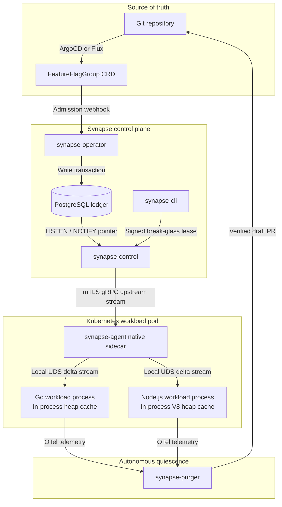
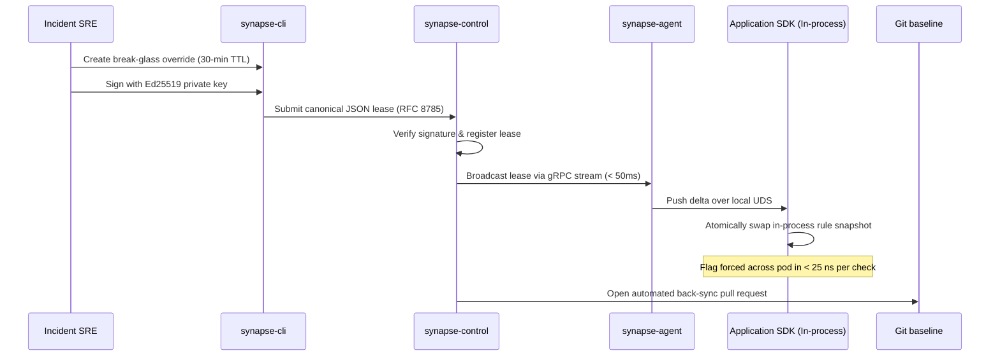

# Architecture specification: SynapseState

This document explains the architecture, security model, and data plane synchronization protocols of SynapseState.

## System topology and data flow

SynapseState splits feature management into two independent planes:

1. **A declarative control plane** that reconciles Git declarations, manages cryptographic overrides, and streams binary deltas.
2. **A sidecar-multiplexed in-process data plane** that evaluates flags directly from language-native heap memory with zero network calls and zero syscalls on the evaluation path.

## Source of truth hierarchy

SynapseState eliminates split-brain conditions by enforcing a strict, one-way hierarchy:

1. **Git repository (authoritative baseline).** The Git repository holds the desired steady-state configuration for all feature flags, variants, and targeting rules.
2. **Kubernetes custom resources (cluster projection).** GitOps agents (such as ArgoCD or Flux) project Git declarations into cluster-scoped `FeatureFlagGroup` custom resources.
3. **PostgreSQL ledger (audit and derived state).** The database records snapshots of valid configurations, stores active and historic emergency leases, and maintains an append-only audit trail. Database triggers emit lightweight metadata pointers over `LISTEN`/`NOTIFY` when rows update:
   `{"generation": 104, "group_id": "checkout", "action": "UPDATE"}`
4. **Upstream gRPC delta stream (propagation bus).** Control plane replicas receive the database notification, compile the binary delta, and broadcast the payload over long-lived HTTP/2 gRPC connections to connected sidecar agents.
5. **Local IPC delta stream (pod multiplexer).** The `synapse-agent` sidecar maintains a single upstream connection per pod. It forwards parsed deltas over a local Unix domain socket (or Windows named pipe) to application processes only when state changes.
6. **In-process heap cache (runtime evaluation).** Application SDKs store rules in native language heap memory. All flag evaluations resolve in-process in 10 to 25 nanoseconds.

## Data plane architecture

### Sidecar delta streaming and in-process heap synchronization

Unlike proxy sidecars that evaluate flags over network sockets per request, SynapseState keeps the evaluation path entirely in-process:

* **Local transport:** Communication between `synapse-agent` and workload SDKs occurs over a local Unix domain socket mounted via an intra-pod volume (`/var/run/synapse/synapse.sock`). On Windows development environments, the SDK falls back to local named pipes.
* **Handshake and delta framing:**
  1. When an application process initializes, the SDK connects to the local socket and requests the full configuration state.
  2. The agent responds with a complete generation snapshot.
  3. Thereafter, the connection remains open. When upstream changes arrive, the agent pushes compact Protobuf deltas containing only modified, added, or deleted rules.
* **Lock-free generation swaps:**
  When a delta arrives, the SDK compiles the new ruleset into an immutable in-memory map or array. The SDK then executes an atomic pointer swap on the active configuration reference:
  - In Go: `atomic.Pointer[RuleSet]` provides atomic reads and swaps with zero lock contention.
  - In Node.js: A module-scoped reference swap guarantees that ongoing evaluations finish against their current snapshot while subsequent evaluations immediately read the new snapshot.
* **Automatic memory reclamation:**
  Superseded ruleset snapshots are collected automatically by the language runtime's garbage collector once all referencing evaluation frames complete. There are no manual memory unmappings (`munmap`), zero page-fault pauses, and zero `SIGSEGV` or `SIGBUS` process crash hazards.

### Evaluation engine

Rule evaluation is deterministic and executed entirely within application process memory:

1. **Flag lookup:** O(1) hash map lookup by flag key.
2. **Targeting rules:** Priority-ordered evaluation of contextual conditions (operators: Equals, NotEquals, In, GreaterThan, LessThan, SemverGte).
3. **Rollout bucketing:** When no targeted rule matches, percentage rollouts map context attributes (such as user ID or tenant token) into a bucket between 0 and 9,999 using unsigned 32-bit MurmurHash3.
4. **Zero network calls:** Evaluation never blocks on I/O, socket buffers, or thread context switches.

## Emergency overrides and tiered cryptographic leases

During production incidents, waiting 5 to 10 minutes for GitOps pull requests to merge is unacceptable. SynapseState provides a tiered emergency lease protocol designed to resolve outages in under 30 seconds without creating single-credential compromise hazards.

### Tiered lease authorization rules

1. **Tier 1 (Single-operator break-glass lease):**
   - Requires one valid Ed25519 signature from an authorized SRE.
   - Enforces a mandatory maximum time-to-live (TTL) of 30 minutes.
   - Propagates cluster-wide in under 50 milliseconds, allowing immediate incident mitigation without waiting for a second signer at 2 AM.
2. **Tier 2 (Dual-control promotion):**
   - To extend an emergency lease beyond 30 minutes, an independent approver must co-sign the lease using their Ed25519 private key, or the automated GitOps back-sync PR must be merged.
3. **RFC 8785 canonical JSON:** Leases serialize into a deterministic byte stream before signing, ensuring cryptographic reproducibility across polyglot tooling.
4. **GitOps sync loop protection:** While an emergency lease is active, the agent annotates cluster state. GitOps reconcilers (such as ArgoCD or Flux) respect the active lease overlay, preventing automated sync loops from reverting the emergency fix.
5. **Local monotonic expiration:** Agents convert lease expiration timestamps into local monotonic deadlines upon receipt, protecting against NTP clock manipulation.

## Cold starts and offline resilience

SynapseState handles infrastructure failures without blocking application workloads:

* **Kubernetes 1.29+ native sidecars:** The `synapse-agent` container runs as a native sidecar with `restartPolicy: Always`. The application container does not start until the agent's `/readyz` probe confirms that the local socket is active and initialized.
* **Local disk snapshot fallback:** The agent writes periodic snapshots of valid generations to local disk storage. If a pod schedules while the central control plane is temporarily unreachable, the agent loads the snapshot from disk, initializes the local socket, and allows the application container to start immediately.
* **Probe isolation:** The agent's liveness probe (`/healthz`) checks only local process health. It never checks upstream database or control plane connectivity. If upstream networks fail, the agent continues serving the active configuration to local SDKs.

## Autonomous code pruning pipeline

SynapseState eliminates dead feature flags from codebases through its Quiescence engine (`synapse-purger`).

### Flag lifecycle taxonomy

To prevent deleting operational kill switches and disaster recovery fallbacks, every flag specifies an explicit lifecycle in its schema:

* `release`: Temporary flags used for gradual feature rollouts. Eligible for automated pruning.
* `experiment`: Multivariate A/B tests with finite lifespans. Eligible for automated pruning.
* `killswitch`: Permanent operational circuit breakers. Permanently excluded from automated pruning.
* `permission`: Long-lived entitlement or tiering gates. Permanently excluded from automated pruning.

### Mathematical Quiescence ($Q$)

A release flag qualifies for automated deletion when it demonstrates statistical invariance across all production environments over a full observation window ($\tau \ge 30\text{ days}$):

$$Q(f, \tau) = \frac{\sum_{e \in \mathcal{E}_{\text{valid}}(f, \tau)} \mathbb{I}(\text{variant}(e) = v_{\text{dominant}})}{\vert{}\mathcal{E}_{\text{valid}}(f, \tau)\vert{}}$$

Where:
* Total valid evaluations $\ge 100,000$.
* Degraded evaluations (errors or fallbacks) $\le 1\%$.
* Flag evaluates to the identical dominant variant across 100% of production clusters.
* Flag lifecycle is explicitly `release` or `experiment`.

### Guarded two-phase deletion protocol

1. **Phase 1: Source code pruning with CI validation.**
   - The purger scans application repositories using semantic AST tools (`ts-morph` for TypeScript, `go/types` for Go).
   - It inlines the dominant variant branch, removes dead conditional blocks, and cleans up unreferenced imports.
   - **Pre-flight compiler verification:** The purger executes language type checks (e.g. `tsc --noEmit`) to verify that removing conditional branches has not disrupted control-flow type narrowing.
   - **Pre-flight test verification:** The purger executes the repository test suite to identify and update any unit test mocks asserting flag evaluations.
   - The purger opens a **Draft Pull Request** with telemetry proofs attached. A human reviewer verifies and merges the PR.
2. **Phase 2: Configuration pruning.**
   - After the Phase 1 PR merges and deploys, the control plane observes runtime telemetry for 7 days.
   - Once evaluation counts for the flag drop to zero across all production pods, the control plane opens an automated PR to remove the flag definition from Git.
