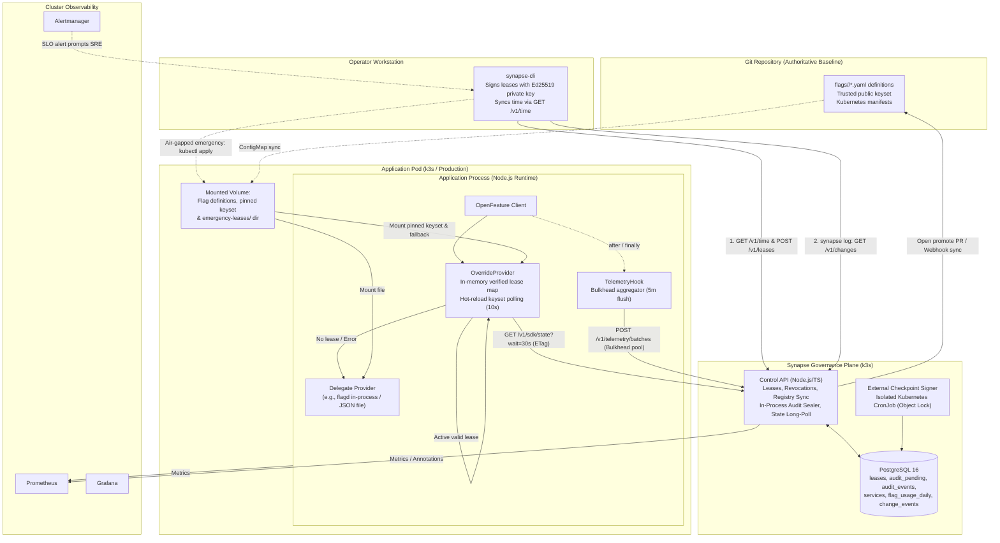
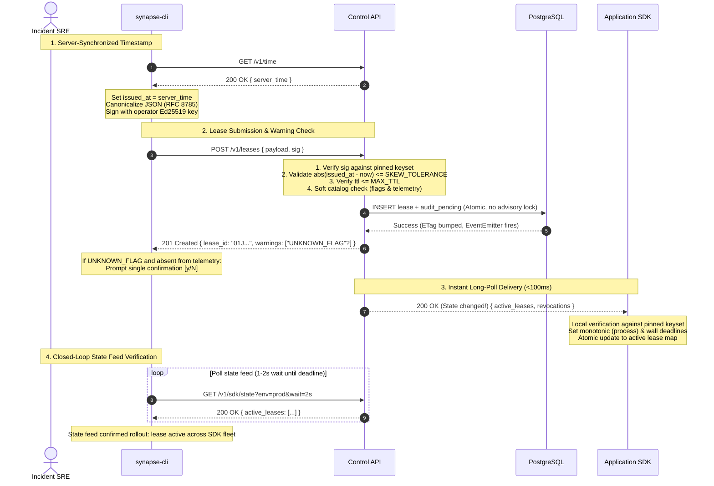
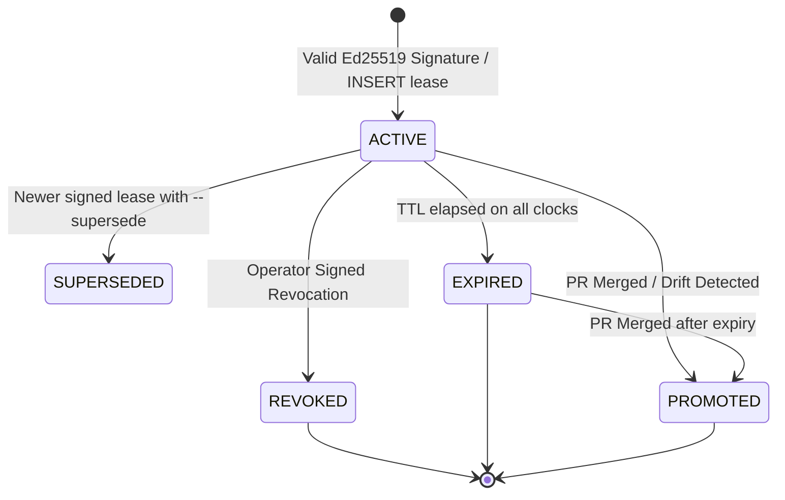
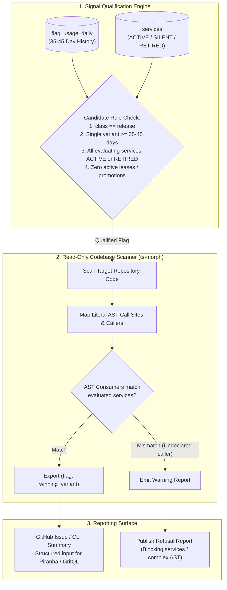

# SynapseState: System Architecture Specification

> **Status:** Active Engineering Baseline  
> **Classification:** Cloud-Native Incident-Safety & Lifecycle Layer for OpenFeature  
> **Companion Document:** [PRODUCT.md](file:///c:/Users/adity/Desktop/Projects/SynapseState/PRODUCT.md)  
> **Roadmap:** [docs/ROADMAP.md](file:///c:/Users/adity/Desktop/Projects/SynapseState/docs/ROADMAP.md)  
> **Limitations:** [docs/limitations.md](file:///c:/Users/adity/Desktop/Projects/SynapseState/docs/limitations.md)

---

## 1. Architectural Philosophy, Goals & Constraints

SynapseState provides an incident-safety, governance, and automated lifecycle layer on top of standard [OpenFeature](https://openfeature.dev) providers. Rather than re-implementing flag evaluation engines, targeting languages, or percentage rollout algorithms, SynapseState augments existing providers with cryptographic emergency overrides, GitOps reconciliation, and compiler-verified code retirement.

```
                           ┌──────────────────────────────────────────────┐
                           │               SynapseState                   │
                           │   Incident Safety & Governance Layer        │
                           └──────────────┬───────────────────────────────┘
                                          │ wraps & delegates
                                          ▼
                           ┌──────────────────────────────────────────────┐
                           │          OpenFeature Provider                │
                           │  (flagd in-process, Unleash, Flipt, JSON)    │
                           └──────────────────────────────────────────────┘
```

### Core System Goals

1. **In-Process Signed Overrides:** Emergency break-glass leases signed with Ed25519, enforced locally inside application process memory, and guaranteed to fail static if the control plane is partitioned or offline.
2. **Deterministic Auto-Expiry:** Rigorous dual-clock bounds (monotonic elapsed time since first observation combined with wall-clock absolute deadlines) guaranteeing that no override outlives its lease.
3. **Automated Git Reconciliation:** Break-glass overrides reconcile back into the authoritative Git repository via automated Pull Requests, where human code review serves as the second approval.
4. **Context-Free Stale Detection:** Aggregate runtime evaluation telemetry to identify dead release toggles without ever logging or egressing evaluation context, user attributes, or targeting keys.
5. **Telemetry-Driven Codebase Scanning:** Read-only AST scanner and qualification engine (`synapse-purger`) identifying dead toggles and exporting structured candidate reports for external refactoring tools, with strict refusal-by-default for ambiguous syntax and zero untrusted code execution.
6. **Incident Change Attribution:** Rapid correlation between service degradation and recent flag transitions/merges via `synapse log`, providing on-call engineers with ranked suspects and type-aware mitigation commands.

### Engineering Constraints

- **Single Developer / Small Team Execution:** Entire codebase implemented in TypeScript/Node.js, allowing focus on infrastructure, reliability, and security practices rather than cross-compilation overhead.
- **Cost-Effective Infrastructure:** Designed to run on a single lightweight virtual machine running k3s, with automated teardown and recreation via Terraform.
- **Fail-Safe Hot Path:** SynapseState must never disrupt or block application flag evaluation. Any internal SDK error fails open by falling back directly to the delegate OpenFeature provider.

---

## 2. High-Level System Context & Topology



---

## 3. Monorepo Component Architecture

```
synapsestate/
├── apps/
│   ├── control-api/        # Node.js + Postgres governance service (HTTP API)
│   ├── dashboard/          # Read-mostly Next.js operations portal with OIDC RBAC
│   ├── demo-shop/          # Realistic microservice app using SDK (fault-injection target)
│   └── purger/             # Read-only TypeScript AST scanner & qualifier (ts-morph)
├── packages/
│   ├── lease/              # Shared cryptographic core: RFC 8785, Ed25519, verification
│   ├── sdk/                # Pure TypeScript OpenFeature OverrideProvider & TelemetryHook
│   ├── cli/                # SRE command-line tool (synapse)
│   └── conformance/        # Language-neutral test vectors (JSON) and test runner
├── deploy/
│   ├── terraform/          # Cloud VM, networking, firewall, DNS, object storage
│   ├── helm/               # Helm charts for Control API, Postgres, Observability
│   └── gitops/             # GitOps deployment manifests (Phase 7)
├── load/                   # k6 load-testing suites for state polling and telemetry
└── docs/
    ├── ARCHITECTURE.md     # This authoritative specification
    ├── ROADMAP.md          # Phased delivery roadmap & kill criteria
    ├── limitations.md      # Documented system boundaries and failure modes
    ├── adr/                # Architectural Decision Records
    ├── runbooks/           # Operator disaster recovery and incident runbooks
    └── postmortems/        # Failure injection reports and retrospectives
```

### The In-Process SDK Architecture: Wrapper Provider & Hook

OpenFeature’s architecture cleanly accommodates SynapseState through two native extension points:

1. **`OverrideProvider`:** Implements the OpenFeature `Provider` interface. It maintains an in-memory map of currently active, cryptographically verified leases. Upon evaluation:
   - It checks whether an active, valid lease exists for the requested `flagKey`.
   - If present and valid, it returns the lease value immediately, setting resolution metadata:
     `reason = "OVERRIDE"`, `metadata = { leaseId: "01J...", issuedBy: "sre-alice" }`.
   - If no lease exists, or if the lease has expired, it delegates directly to the underlying **`DelegateProvider`** (e.g., `flagd` reading a local JSON ConfigMap).
   - If an internal exception occurs inside the wrapper, it catches the error, increments an error counter, and falls through to the delegate provider.
2. **`TelemetryHook`:** Implements OpenFeature `after` and `finally` lifecycle hooks. It records evaluation outcomes `(flag_key, variant, reason)` in an in-memory ring buffer. It **never inspects or accesses evaluation context**, guaranteeing zero privacy leakage.

---

## 4. System Data Flows & Protocols

### 4.1 State Delivery Protocol: ETag Long-Polling (Control Plane to SDK)

State synchronization uses HTTP long-polling with `ETag` conditional caching:

```
Application SDK                                   Control API
      │                                                │
      │─── GET /v1/sdk/state?env=prod&wait=30s ───────►│
      │    If-None-Match: "33a64df5"                   │
      │    Authorization: Bearer <service_token>       │
      │                                                │
      │    (Server holds connection up to 30s)         │
      │    (Instant wake-up if state ETag changes)     │
      │                                                │
      │◄── 304 Not Modified ───────────────────────────│ (No change when 30s expires)
      │    (re-poll immediately with backoff on error) │
      │                                                │
      │─── GET /v1/sdk/state?env=prod&wait=30s ───────►│
      │    If-None-Match: "33a64df5"                   │
      │                                                │
      │◄── 200 OK (ETag: "7c91e2b8") ──────────────────│ (Immediate delivery on update)
      │    { server_time, active_leases, revocations,  │
      │      key_revocations, registry_version }       │
      ▼                                                ▼
```

- **Long-Poll Contract:** `GET /v1/sdk/state?env={env}&wait=30s` (maximum `60s`, default `0s` for plain polling).
  - Single wire contract: Plain polling is simply `wait=0`.
  - In-memory cache: Token hashes and active ETags are verified in Node.js memory, bypassing database queries on `304 Not Modified`.
  - On single node, state mutations wake suspended requests via in-process `EventEmitter`; on clustered nodes, via Postgres `LISTEN`/`NOTIFY`.
  - Reconnect storm defense: Random jitter (1–3s) and exponential backoff on connection drop.
- **Payload Contents:**
  - `server_time`: Authoritative server timestamp.
  - `active_leases`: Array of cryptographically signed lease envelopes.
  - `revocations`: Array of signed lease revocation records. **Bounded retention:** Only includes revocations where `expires_at >= server_time` (automatically pruned when the underlying lease would have naturally expired).
  - `key_revocations`: Array of signed key revocation records (`synapsestate/keyrevocation/v1\n`).
  - `registry_version`: Monotonic sequence version of the flag catalog.
- **Authentication:** Service-scoped bearer tokens, stored hashed (SHA-256) server-side and cached in memory.

### 4.2 Emergency Lease Creation Flow



### 4.3 Git Reconciliation & Promotion Flow

```
synapse promote <lease_id>
       │
       ▼
Control API (via GitHub App) opens Pull Request:
  - Branch: synapse/promote-lease-01J...
  - Target: flags/<env>/<flag_key>.yaml
  - Description: Links incident reason, lease ID, and operator signature
       │
       ▼
GitHub CODEOWNERS & Branch Protection:
  - Requires independent peer review and approval
  - Human review acts as the formal second approval (Dual-Control)
       │
       ▼
PR Merged into default branch
       │
       ▼
GitHub Webhook triggers Control API:
  - State moves to PROMOTED
  - Generates signed revocation for the temporary lease
  - Inserts GIT_MERGE and LEASE_PROMOTED events into change_events and audit_pending
```

#### Directory Layout & GitOps Constraints

- **Per-Flag File Structure:** Flag definitions live in individual files under `flags/<env>/<flag_key>.yaml`.
  - _Charset Invariant:_ Flag keys must match `^[a-z0-9]([-a-z0-9]*[a-z0-9])?$` (lowercase alphanumeric and hyphens). This satisfies Kubernetes ConfigMap key constraints (`[-._a-zA-Z0-9]+`) and prevents file collisions on case-insensitive filesystems (e.g. Windows/macOS). CI lints enforce `filename == key`.
  - _Schema Unification:_ Each `<flag_key>.yaml` houses both governance registry metadata (`class`, `owner`, `description`) and delegate variant definitions (`variants`, `defaultVariant`).
- **Delegate Single-File Merging:** For OpenFeature providers that require a single file path rather than a directory source, a pre-commit hook or CI pipeline merges `flags/<env>/*.yaml` into a single `dist/<env>/flags.json` ConfigMap artifact.
- **Stale PR & Conflict Handling:** Concurrent promotions on different flags never collide. If two promotions target the same flag, the second PR is flagged `STALE_PR_CONFLICT` by the Control API, prompting automated rebase or human resolution.
- **Provider Scope:** Automated Git promotion in v1 is scoped strictly to Git-backed providers (e.g. `flagd` in-process, JSON/YAML file providers). For SaaS or external-database providers (e.g. Unleash), baselines are managed externally; promotion to Git is documented as out of scope for v1.

### 4.4 Telemetry Collection & Bulkhead Pipeline

1. **In-Memory Buffering:** The `TelemetryHook` increments counters in a local hash map keyed by `(flag_key, variant, reason)`.
2. **Periodic Flushing:** Flushes every **5 minutes** (default) with 30s randomized jitter to `POST /v1/telemetry/batches`. (Staleness requires 35–45 day observation, so 5-minute granularity provides 5× lower database write volume without sacrificing accuracy).
3. **Sorted Key Invariant:** Batches sort metric keys deterministically by `(flag_key ASC, variant ASC, reason ASC)` prior to serialization, preventing PostgreSQL row-lock deadlocks during concurrent multi-row upserts.
4. **Dedicated Connection Pool & Load Shedding:** Telemetry ingestion is served by an isolated PostgreSQL connection pool. Under peak load, the Control API sheds telemetry with `429 Too Many Requests` or `503 Service Unavailable`. The SDK catches these errors non-blockingly, drops the batch, and increments `dropped_total`. **Telemetry load never starves or blocks emergency lease operations.**
5. **Propagation Lag Measurement:** Because `lease.issued_at` is synchronized via `GET /v1/time`, the client calculation:
   $$\text{propagation\_lag\_ms} = \text{server\_time}_{\text{poll\_response}} - \text{lease.issued\_at}$$
   is strictly based on the server clock, eliminating client clock drift.

---

## 5. Cryptographic Lease Specification & Verification

### 5.1 Canonical Payload Schema (RFC 8785)

All emergency leases are constructed as deterministic JSON objects canonicalized under **RFC 8785** before signing:

```json
{
  "v": 1,
  "lease_id": "01J9X57YTRPQ8A7F4E12345678",
  "env": "prod",
  "flag_key": "checkout-v2",
  "value": false,
  "reason": "INC-142: Database connection pool exhaustion",
  "issued_at": "2026-10-06T02:14:00.000Z",
  "ttl_seconds": 1800,
  "kid": "sre-alice-2026-01",
  "nonce": "NzkxZDJiODRhYTgz..."
}
```

- **Domain Separation:** Before signing, a prefix byte string (`"synapsestate/lease/v1\n"`) is prepended to the canonical payload bytes. This guarantees that signatures cannot be transplanted across protocol message types.
- **Revocation Message Schema:** Revocations use domain prefix `"synapsestate/revocation/v1\n"` over canonical payload:
  `{ "v": 1, "lease_id": "...", "revoked_at": "...", "kid": "...", "reason": "..." }`.
- **Signed Key Revocation Schema:** Key revocations use domain prefix `"synapsestate/keyrevocation/v1\n"` over canonical payload:
  `{ "v": 1, "kid": "compromised-key-id", "revoked_at": "...", "revoked_by_kid": "security-admin", "reason": "..." }`.
  Key revocations must be signed by an active key possessing the `key_revoker` role in the pinned keyset.

### 5.2 Trust Root Architecture, Pluggable Signer & Keyset Lifecycle

To protect against control-plane compromise while preserving rapid revocation agility:

#### 1. Operator Key Storage: Pluggable Signer Interface

The CLI uses an extensible `Signer` interface:

```typescript
export interface Signer {
  readonly kid: string;
  sign(message: Uint8Array): Promise<string>; // base64url Ed25519 signature
}
```

- **Default Pure-TypeScript Implementation (`EncryptedKeyfileSigner`):**
  - Stored at `~/.synapse/keys/<kid>.key`.
  - Encrypted with AES-256-GCM using keys derived via `crypto.scrypt` with a mandatory non-empty passphrase.
  - Header explicitly specifies algorithm version, salt, scrypt parameters ($N, r, p$), and initialization vector.
  - AAD (Additional Authenticated Data) cryptographically binds the `kid` and file format version to the ciphertext.
  - Filesystem hygiene: Strictly enforces POSIX file mode `0600` (fails if group/world readable) and logs security warnings on Windows.
- **Separation from SSH Credentials:** SynapseState strictly avoids reusing `~/.ssh/id_ed25519` directly, preserving cryptographic trust domains. Pluggable signer implementations (such as `@napi-rs/keyring` for OS Keychain or SSH-agent / SSHSIG) can be configured without modifying the core cryptographic engine.
- **On-Call Redundancy & Generation Tooling:** Team policies mandate at least **two authorized key holders** on every on-call rotation. The CLI provides `synapse key generate` and `synapse key export-public` to automate keyset PR generation.

#### 2. Git-Managed Keyset & Bounded Cache Fallback

- **Git Source of Truth:** The trusted keyset (`kid -> { publicKey, roles, max_ttl_seconds, status }`) is committed to Git and mounted into workload pods as a Kubernetes ConfigMap volume.
  - Per-key `max_ttl_seconds` restricts blast radius (e.g. 1 hour default for standard SREs, 24 hours reserved for principal leads).
- **Hot Reload via File-Hash Polling:** SDKs poll `SHA-256(fileContent)` of `/etc/synapse/keyset/keyset.json` every **10 seconds**.
  - _Invariant:_ Does not use `fs.watch` (which fails on Kubernetes symlink swaps) and prohibits `subPath` mounts (which never receive ConfigMap updates).
- **Bounded In-Memory Fallback Cache:**
  - The SDK caches the parsed keyset in memory alongside a `keyset_verified_at` timestamp and exports `synapse_sdk_keyset_age_seconds`.
  - **Bounded Staleness Ceiling:** If filesystem reads repeatedly fail due to volume turbulence, the cache is honored up to a maximum threshold of **15 minutes**. Beyond 15 minutes of failed reads, the SDK stops accepting _new_ leases (fail-static for overrides). Already-verified leases continue until their deadlines elapse, and baseline flag evaluation continues unaffected via the delegate provider.
  - **Cold-Start Resilience:** If a pod starts cold with an unreadable keyset file, it boots with overrides disabled and exports a degraded metric (`synapse_sdk_keyset_status{state="unreadable"}`), without failing pod liveness or readiness probes.
  - **Read Hygiene:** Retries on transient `ENOENT`/`EIO` symlink swap errors; parse errors retain the last valid keyset; a valid empty JSON `{}` is processed as a legitimate "revoke all keys" command, immediately purging all active leases.
- **Signed Fast-Path Key Invalidation:** The Control API distributes signed key revocations (`synapsestate/keyrevocation/v1\n`). These are deny-only: the Control API can revoke a key immediately across long-poll streams, but cannot add trust or resurrect revoked keys.
- **In-Flight Lease Re-validation:** Whenever a keyset reload or key revocation occurs, the SDK re-evaluates all active leases in memory. Any lease signed by a missing or revoked key is immediately evicted.
- **Air-Gapped Emergency Fallback Directory:** In addition to long-polling the Control API, SDKs scan `/etc/synapse/emergency-leases/*.json` on startup and on file-hash changes. SREs can apply overrides via `kubectl apply` directly during control plane outages.

### 5.3 SDK Dual-Clock Verification Algorithm

To protect against both NTP clock tampering and replay attacks, SDKs enforce dual-clock bounds:

```python
def verify_lease(envelope, pinned_keyset, active_key_revocations, now_wall, now_mono):
    # 1. Schema and Identity Check
    if envelope.v != 1: return REJECT_UNSUPPORTED_VERSION
    if envelope.payload.kid in active_key_revocations: return REJECT_REVOKED_KEY
    key_entry = pinned_keyset.get(envelope.payload.kid)
    if not key_entry or key_entry.status != "ACTIVE": return REJECT_UNKNOWN_KEY
    if "lease_signer" not in key_entry.roles: return REJECT_UNAUTHORIZED_ROLE

    # 2. Cryptographic Verification
    canonical_bytes = rfc8785_canonicalize(envelope.payload)
    message = "synapsestate/lease/v1\n" + canonical_bytes
    if not ed25519_verify(key_entry.public_key, message, envelope.sig):
        return REJECT_INVALID_SIGNATURE

    # 3. Parameter Validation (Enforce key-specific and global TTL caps)
    ttl = envelope.payload.ttl_seconds
    max_allowed_ttl = min(SDK_MAX_TTL, key_entry.get("max_ttl_seconds", SDK_MAX_TTL))
    if ttl <= 0 or ttl > max_allowed_ttl: return REJECT_INVALID_TTL

    # 4. Anti-Future Skew Check
    issued_at = parse_iso8601(envelope.payload.issued_at)
    if issued_at > now_wall + SKEW_TOLERANCE:
        return REJECT_FUTURE_TIMESTAMP

    # 5. Wall Clock Expiry (Absolute safety ceiling across pod restarts)
    wall_expiry = issued_at + ttl + SKEW_TOLERANCE
    if now_wall >= wall_expiry:
        return REJECT_EXPIRED

    # 6. Monotonic Relative Expiry (Scoped strictly per process incarnation)
    if envelope.payload.lease_id not in local_lease_store:
        first_seen_mono = now_mono
    else:
        first_seen_mono = local_lease_store[envelope.payload.lease_id].first_seen_mono

    mono_expiry = first_seen_mono + ttl

    # 7. Effective Expiry (Strict Minimum of wall and process-monotonic deadlines)
    effective_expiry = min(wall_expiry, mono_expiry)

    # 8. Local Revocation Check
    if envelope.payload.lease_id in local_revocations:
        return REJECT_REVOKED

    return ACCEPT_VALID_LEASE
```

- **Process-Incarnation Monotonic Invariant:** Monotonic expiry (`first_seen_mono + ttl`) protects against wall-clock NTP jumps occurring within a single process incarnation. Upon pod crash or cold restart, the monotonic counter resets, but the absolute wall-clock ceiling (`issued_at + ttl + SKEW_TOLERANCE`) unconditionally bounds the lease lifetime.
- **Supersession & Conflict Resolution:** When multiple valid leases exist for the same `(flag_key, env)`:
  - The winner is deterministically chosen by `issued_at DESC`, breaking ties with `lease_id (ULID) DESC`.
  - Superseded leases are dropped immediately without waiting for TTL expiry.

### 5.4 Fail-Static Offline Behavior

When the Control API is unreachable:

- **Fail-Static:** The SDK continues honoring already-verified leases until their individual monotonic/wall deadlines elapse. Leases are never automatically extended.
- **Air-Gapped Out-of-Band Channel:** If the Control API is down, operators can mount signed leases via ConfigMap directly into application pods.
- **Delegate Continuity:** Regular evaluations fall through to the delegate provider unaffected.

---

## 6. Emergency Lease State Machine



### Transition Specifications

| Current State | Target State   | Triggering Event                                       | Side Effects & Invariants                                                              |
| ------------- | -------------- | ------------------------------------------------------ | -------------------------------------------------------------------------------------- |
| _(None)_      | **ACTIVE**     | Valid signed `POST /v1/leases`                         | Emits `LEASE_CREATED` audit event; increments active gauge; bumps state ETag.          |
| **ACTIVE**    | **SUPERSEDED** | Newer signed lease with `--supersede` flag             | Old lease set to SUPERSEDED and new lease inserted in the **same atomic transaction**. |
| **ACTIVE**    | **REVOKED**    | Signed `POST /v1/leases/:id/revoke`                    | Revocation recorded; pushed to SDKs on next poll; audit event emitted.                 |
| **ACTIVE**    | **EXPIRED**    | Server-side reaper detects `now >= issued_at + ttl`    | Emits `LEASE_EXPIRED` audit event; fires alert if lease was never promoted.            |
| **ACTIVE**    | **PROMOTED**   | GitHub PR merged webhook or reconciliation drift check | State set to PROMOTED; associated lease revoked; audit event links merge commit.       |
| **EXPIRED**   | **PROMOTED**   | Late PR merge after lease had already expired          | State set to PROMOTED; audit event records `after_expiry = true`.                      |

---

## 7. Relational Data Model (PostgreSQL)

```sql
-- Core Flag Registry (Synchronized from Git flags/<env>/*.yaml)
CREATE TABLE flags (
    key VARCHAR(128) NOT NULL,
    env VARCHAR(64) NOT NULL,
    class VARCHAR(32) NOT NULL CHECK (class IN ('release', 'killswitch', 'permanent')),
    owner VARCHAR(128) NOT NULL,
    description TEXT,
    registry_version BIGINT NOT NULL DEFAULT 1,
    created_at TIMESTAMPTZ NOT NULL DEFAULT NOW(),
    updated_at TIMESTAMPTZ NOT NULL DEFAULT NOW(),
    PRIMARY KEY (key, env)
);

-- Break-Glass Emergency Leases (Soft Reference to flags: no FK constraint)
CREATE TABLE leases (
    lease_id VARCHAR(32) PRIMARY KEY, -- ULID
    flag_key VARCHAR(128) NOT NULL,
    env VARCHAR(64) NOT NULL,
    payload JSONB NOT NULL,
    sig TEXT NOT NULL,
    state VARCHAR(32) NOT NULL CHECK (state IN ('ACTIVE', 'SUPERSEDED', 'REVOKED', 'EXPIRED', 'PROMOTED')),
    issued_at TIMESTAMPTZ NOT NULL,
    ttl_seconds INT NOT NULL CHECK (ttl_seconds > 0 AND ttl_seconds <= 86400),
    expires_at TIMESTAMPTZ NOT NULL,
    created_by_kid VARCHAR(128) NOT NULL,
    promote_pr_url TEXT,
    created_at TIMESTAMPTZ NOT NULL DEFAULT NOW()
    -- NOTE: Unconstrained flag_key/env guarantees emergency overrides never fail during catalog sync lag
);

-- Partial Unique Index: Only ONE active lease per flag per environment
CREATE UNIQUE INDEX idx_active_lease_per_flag_env
ON leases (flag_key, env)
WHERE state = 'ACTIVE';

CREATE INDEX idx_leases_expires_at ON leases (expires_at) WHERE state = 'ACTIVE';

-- Signed Lease Revocations (Exact retention: expires_at mirrors lease target)
CREATE TABLE revocations (
    lease_id VARCHAR(32) PRIMARY KEY REFERENCES leases(lease_id),
    payload JSONB NOT NULL,
    sig TEXT NOT NULL,
    revoked_by_kid VARCHAR(128) NOT NULL,
    revoked_at TIMESTAMPTZ NOT NULL DEFAULT NOW(),
    expires_at TIMESTAMPTZ NOT NULL -- Target lease expires_at + SKEW_TOLERANCE
);

CREATE INDEX idx_revocations_expires_at ON revocations (expires_at);

-- Signed Fast-Path Key Revocations
CREATE TABLE key_revocations (
    kid VARCHAR(128) PRIMARY KEY,
    payload JSONB NOT NULL,
    sig TEXT NOT NULL,
    revoked_by_kid VARCHAR(128) NOT NULL,
    revoked_at TIMESTAMPTZ NOT NULL DEFAULT NOW()
);

-- Registered Microservice Workloads (Per-Flag Consumer Lifecycle)
CREATE TABLE services (
    name VARCHAR(128) NOT NULL,
    env VARCHAR(64) NOT NULL,
    status VARCHAR(32) NOT NULL DEFAULT 'ACTIVE' CHECK (status IN ('ACTIVE', 'SILENT', 'RETIRED')),
    first_seen TIMESTAMPTZ NOT NULL DEFAULT NOW(),
    last_seen TIMESTAMPTZ NOT NULL,
    silent_since TIMESTAMPTZ,
    retired_at TIMESTAMPTZ,
    sdk_version VARCHAR(32) NOT NULL,
    PRIMARY KEY (name, env)
);

-- Daily Aggregated Flag Telemetry (HOT-optimized fillfactor, sorted key updates)
CREATE TABLE flag_usage_daily (
    flag_key VARCHAR(128) NOT NULL,
    env VARCHAR(64) NOT NULL,
    service VARCHAR(128) NOT NULL,
    variant VARCHAR(64) NOT NULL,
    usage_date DATE NOT NULL,
    eval_count BIGINT NOT NULL DEFAULT 0,
    first_seen TIMESTAMPTZ NOT NULL,
    last_seen TIMESTAMPTZ NOT NULL,
    PRIMARY KEY (flag_key, env, service, variant, usage_date)
) WITH (fillfactor = 70);

CREATE INDEX idx_flag_usage_daily_env_date ON flag_usage_daily (env, usage_date, service);

-- Asynchronous Staging Buffer for Audit Events (Zero request lock contention)
CREATE TABLE audit_pending (
    id BIGSERIAL PRIMARY KEY,
    created_at TIMESTAMPTZ NOT NULL DEFAULT NOW(),
    actor VARCHAR(128) NOT NULL,
    event_type VARCHAR(64) NOT NULL,
    payload JSONB NOT NULL
);

-- Cryptographically Sealed Append-Only Audit Ledger
CREATE TABLE audit_events (
    seq BIGSERIAL PRIMARY KEY,
    ts TIMESTAMPTZ NOT NULL,
    actor VARCHAR(128) NOT NULL,
    event_type VARCHAR(64) NOT NULL,
    payload JSONB NOT NULL,
    prev_hash VARCHAR(64) NOT NULL,
    hash VARCHAR(64) NOT NULL
);

-- Incident & Audit Change Events (Powers synapse log pull-based attribution)
CREATE TABLE change_events (
    id BIGSERIAL PRIMARY KEY,
    event_type VARCHAR(64) NOT NULL CHECK (event_type IN ('LEASE_CREATED', 'LEASE_REVOKED', 'LEASE_SUPERSEDED', 'LEASE_EXPIRED', 'LEASE_PROMOTED', 'GIT_MERGE')),
    env VARCHAR(64) NOT NULL,
    flag_key VARCHAR(128),
    actor VARCHAR(128) NOT NULL,
    occurred_at TIMESTAMPTZ NOT NULL DEFAULT NOW(),
    payload JSONB NOT NULL
);

CREATE INDEX idx_change_events_lookup ON change_events (env, occurred_at DESC);
CREATE INDEX idx_change_events_flag ON change_events (flag_key, env, occurred_at DESC) WHERE flag_key IS NOT NULL;

-- API Service & Automation Tokens
CREATE TABLE api_tokens (
    token_id VARCHAR(32) PRIMARY KEY,
    token_hash VARCHAR(64) NOT NULL, -- SHA-256
    service_name VARCHAR(128) NOT NULL,
    env VARCHAR(64) NOT NULL,
    roles TEXT[] NOT NULL,
    created_at TIMESTAMPTZ NOT NULL DEFAULT NOW(),
    rotated_at TIMESTAMPTZ
);
```

---

## 8. Tamper-Evident Audit Ledger & Asynchronous Sealer

### 8.1 Request-Path Decoupling

In the same short database transaction as any administrative state change (e.g. lease creation, revocation, or Git promotion webhook), the Control API inserts an un-hashed record into `audit_pending` and an entry into `change_events`. No global advisory lock is acquired on the request path, ensuring zero lock contention or latency penalty during high-pressure incidents.

### 8.2 In-Process Asynchronous Sealer

A background sealing loop runs directly within the `control-api` service process, requiring no external secrets or separate long-running daemon:

1. **Transaction-Level Advisory Locking:**
   - To support multiple Control API replicas and compatibility with PgBouncer in transaction pooling mode, the sealer executes:
     ```sql
     SELECT pg_try_advisory_xact_lock(hashtext('synapse_audit_sealer'));
     ```
     inside each seal transaction. If another replica or connection currently holds the lock, `pg_try_advisory_xact_lock` returns `false`, and the tick skips cleanly without waiting.
   - _Invariant:_ Avoids session-level advisory locks (`pg_try_advisory_lock`), which silently break or leak when connections are recycled by pools or load balancers.
2. **Defensive Loop Hygiene:**
   - **Self-Rescheduling Timer:** Implemented using recursive `setTimeout` with an `isSealing` in-flight guard (never `setInterval`), preventing overlapping batch executions if an individual database batch experiences network or disk latency.
   - **Exception Containment:** The sealing loop is wrapped in a top-level `try/catch` block, ensuring unexpected database errors or rejected promises log structured errors rather than crashing the Node.js runtime.
   - **Capped Batch Size:** Each transaction processes at most **100 events** (`LIMIT 100`), preventing event-loop starvation and bounded heap consumption.
   - **Graceful Shutdown:** The process registers a `SIGTERM` handler that waits for the active in-flight sealing batch to commit before closing the database pool and exiting.
3. **Deterministic Seal Ordering:**
   - Chain order is strictly defined as **seal order**, not insertion `id`.
   - The sealer assigns contiguous sequence numbers (`seq`) in `audit_events`. Because concurrent requests may commit out of order into `audit_pending`, the sealer reads unsealed events ordered by `created_at ASC, id ASC`, computes:
     $$\text{hash}_n = \text{SHA-256}(\text{hash}_{n-1} \parallel \text{RFC8785Canonical}(\text{event}_n))$$
     inserts them into `audit_events`, and deletes them from `audit_pending` within the single locked transaction.
4. **Stall Observability:**
   - The sealer records the oldest pending event timestamp and exports `synapse_audit_pending_age_seconds`. An alert triggers if pending age exceeds 30 seconds, immediately highlighting any stalled sealer.

### 8.3 Isolated External Checkpoint Signer

To maintain strict cryptographic isolation between the read/write API and the external trust anchor:

- **Separate Kubernetes CronJob:** Periodic checkpointing runs as an independent Kubernetes CronJob (`synapse-checkpoint-signer`), completely isolated from the `control-api` process.
- **Isolated Key Material:** The CronJob possesses a dedicated, highly restricted Ed25519 anchoring key and a write-only IAM role to an immutable storage target (e.g., protected Git repository or AWS S3 Object Lock in Compliance Mode).
- **Security Boundary:** Even if the `control-api` container or database connection is compromised, the attacker cannot forge historical checkpoints on the immutable external store.

### 8.4 Verification Utility

SREs and compliance auditors verify ledger integrity using:

```bash
synapse audit verify --from-genesis
```

The command recalculates the SHA-256 chain sequentially from genesis across `audit_events`, validates hash continuity, and verifies matching signed checkpoints against the external write-once store.

---

## 9. Telemetry-Driven Stale Detection & Scanner (`synapse-purger`)



### 9.1 Stale Candidate Qualification Rule

A flag qualifies as a `stale_candidate` if and only if all five conditions hold:

1. **Lifecycle Class:** `class == 'release'`. (`killswitch` and `permanent` flags are strictly excluded).
2. **Invariance Window:** The flag has served a single variant continuously for $\ge 35\text{ to } 45\text{ days}$ (or had 0 evaluations across the entire window).
3. **Per-Flag Consumer Coverage:** Every service $s$ that has recorded evaluations for the flag within data retention has status $\in \{\text{ACTIVE}, \text{RETIRED}\}$.
   - If any evaluating service is `SILENT` (no heartbeat for $> 14\text{ days}$), the flag is blocked from retirement and highlighted as blocked by service $s$.
   - SREs unblock retirement via `synapse service retire --service <name>`.
4. **AST Reference Consistency:** A read-only AST scan of application repositories detects call sites only in known consumer services.
5. **Lease Quiescence:** No active emergency lease or un-finalized promotion exists.

### 9.2 Scanner Scope & Security Boundaries

- **Read-Only Scanner First:** `synapse-purger` operates strictly as a read-only AST scanner and candidate qualifier.
- **No Untrusted Test Execution:** The purger **never** runs `npm test`, `npm run lint`, or arbitrary scripts inside target repositories while holding GitHub App credentials.
- **Tool Interoperability:** Generates structured reports containing exact file paths, line numbers, and `(flag_key, winning_variant)` tuples. This report directly powers external battle-tested refactoring tools (e.g. Uber Piranha, GritQL) or human-reviewed pull requests.

### 9.3 Next.js Operations Dashboard with GitHub OAuth RBAC (`apps/dashboard`)

- **Read-Mostly Operations Portal:** Built using Next.js 15 App Router, React 19, and the Voltage Design System ([design.md](file:///c:/Users/adity/Desktop/Projects/SynapseState/design.md)). Provides real-time visibility into active break-glass leases, TTL countdowns, flag inventory, quiescence evaluations, and sealed audit records without vendor lock-in.
- **Authentication & RBAC:** Enforces GitHub OAuth authentication (`/api/auth/github`, `/api/auth/callback`) with Edge-safe WebCrypto session verification ([apps/dashboard/src/middleware.ts](file:///c:/Users/adity/Desktop/Projects/SynapseState/apps/dashboard/src/middleware.ts)) and sealed JWT cookies (`synapse_session`):
  - `viewer`: Read-only access to cluster state, active leases, flag metrics, and audit chains.
  - `operator`: All viewer capabilities plus operational mutations: triggering lease promotions (`POST /api/actions/promote`) and early revocations (`POST /api/actions/revoke`).
  - `admin`: Full administrative control, team mappings, and audit oversight.
- **Key Safety Invariant (Signing Air-Gap):** The dashboard backend has **zero access to operator private keys and cannot sign emergency leases**. Emergency leases can only be created by operators using the CLI (`synapse lease create`) holding local encrypted keyfiles.
- **Audit Trail Integration:** Administrative actions triggered through the dashboard emit staged audit events (`DASHBOARD_LOGIN`, `DASHBOARD_REVOKE_TRIGGERED`, `DASHBOARD_PROMOTE_TRIGGERED`) via `POST /v1/audit/events` for cryptographic hash-chain sealing.

---

## 10. Security Architecture & Threat Model

| Threat Scenario                        | Impact                                         | Primary Architectural Mitigation                                                                                                        | Residual Risk                                                                                                 |
| -------------------------------------- | ---------------------------------------------- | --------------------------------------------------------------------------------------------------------------------------------------- | ------------------------------------------------------------------------------------------------------------- |
| **Compromised Control API or DB**      | Malicious overrides injected into cluster      | SDKs verify Ed25519 signatures against pinned keyset mounted from Git. Control plane cannot sign leases.                                | Bounded replay within active TTL window; delayed revocation if partitioned.                                   |
| **Dashboard Compromise**               | Unauthorized attempt to create or forge leases | Dashboard backend has zero signing keys and cannot sign leases; all mutations proxy to Control API with session RBAC and audit staging. | Stolen operator token could trigger promotions or revocations, strictly bounded by Git review and audit logs. |
| **Stolen Operator Private Key**        | Attacker signs unauthorized overrides          | Fast-path key revocation envelope (`synapsestate/keyrevocation/v1\n`); SDK file-hash polling (10s); per-key `max_ttl_seconds` caps.     | Window bounded by per-key TTL or fast-path revocation delivery.                                               |
| **Stolen Workload Service Token**      | False telemetry injection; read state          | Scoped tokens, hashed storage, rate limiting, isolated telemetry connection pool.                                                       | Poisoned usage metrics; purger outputs advisory reports, requiring human merge.                               |
| **Replay of Expired Lease**            | Historic override re-applied                   | Dual-clock validation: process-scoped monotonic timer combined with absolute wall-clock ceiling (`issued_at + ttl + SKEW_TOLERANCE`).   | Severe node clock drift combined with cold pod restart (bounded by server timestamp age check).               |
| **Control API / DB Outage**            | SRE blocked from mitigating active incident    | Air-gapped fallback: SDK reads signed leases directly from `/etc/synapse/emergency-leases/` via `kubectl apply`.                        | Requires operator access to apply Kubernetes ConfigMaps directly.                                             |
| **Untrusted Code Execution in Purger** | Credential exfiltration via test/build scripts | Purger operates strictly as a read-only AST scanner; never executes target repository test suites or build commands.                    | Flawed AST parser logic in read-only analysis.                                                                |
| **Database Tampering by DBA**          | Historical audit trail modified                | Append-only SHA-256 hash chaining sealed asynchronously, anchored to external object lock.                                              | Modifications occurring between the last signed checkpoint and detection.                                     |

---

## 11. Observability, SLOs & Incident Attribution

### 11.1 Prometheus Metrics Catalog

- **Control API (`apps/control-api/src/metrics/*`):**
  - `synapse_leases_active{env}`: Gauge of currently active break-glass emergency override leases.
  - `synapse_lease_transitions_total{from, to}`: Counter of lease lifecycle state transitions (`PENDING -> ACTIVE`, `ACTIVE -> REVOKED`, etc.).
  - `synapse_lease_propagation_seconds`: Histogram of end-to-end lease propagation latency between Control API and client workloads.
  - `synapse_state_poll_duration_seconds{status_code}`: Histogram of `/v1/sdk/state` request latency across 200 (immediate update) and 304 (long-poll timeout).
  - `synapse_audit_pending_queue_size`: Gauge of unsealed events in `audit_pending`.
  - `synapse_audit_pending_age_seconds`: Gauge of the oldest unsealed event age in `audit_pending` (alerts if > 30s).
  - `synapse_audit_chain_length`: Gauge of the total monotonic sealed audit chain length.
- **Application SDK (`packages/sdk/src/metrics.ts`):**
  - `synapse_sdk_state_age_seconds`: Age in seconds of the most recently applied state generation.
  - `synapse_sdk_keyset_age_seconds`: Elapsed time since the last successful keyset read from disk (alerts if > 15m).
  - `synapse_sdk_active_overrides`: Number of overrides currently applied in memory.
  - `synapse_sdk_poll_errors_total`: Counter of failed state poll requests.
  - `synapse_sdk_telemetry_dropped_total`: Counter of dropped telemetry batches.

#### Metric Architecture & Cardinality Invariants

1. **Strict Cardinality Audit (Invariant 5):** Prometheus labels are strictly bounded to low-cardinality dimensions (`env`, `status_code`, `reason`, `from`, `to`). High-cardinality values such as user IDs, targeting context attributes, and individual `lease_id` identifiers are **strictly prohibited** from metric labels. Per-lease remaining TTL countdowns are intentionally omitted from Prometheus gauge series and managed via CLI inspection (`synapse lease list`).
2. **Scrape Throttling & Fail-Open Resilience:**
   - The `/metrics` endpoint caches expensive database gauge queries (`leases`, `audit_pending`, `audit_events`) for 5 seconds (`REFRESH_THROTTLE_MS = 5000`) to protect PostgreSQL from scraper denial-of-service.
   - If PostgreSQL is unreachable, the collector logs a warning and returns HTTP 200 with all in-memory instruments intact, ensuring monitoring scrapers never trigger false-positive 500 alert floods during database restarts.
3. **Throwing Collector Protection:** Pluggable SDK metric callbacks are executed within defensive try/catch blocks (`KeysetWatcher.onKeysetUpdate`), guaranteeing that errors in third-party metrics collectors never bubble into the flag evaluation hot path.

### 11.2 Service Level Objectives (SLOs) & Alert Rules

| Metric Boundary                | Target Objective                                    | Verification Strategy                                           | Runbook Reference                                                                                                                 |
| ------------------------------ | --------------------------------------------------- | --------------------------------------------------------------- | --------------------------------------------------------------------------------------------------------------------------------- |
| **State API Availability**     | 99.5% over 30 days (Single node)                    | Google SRE Multi-Window Multi-Burn-Rate Alerts                  | [docs/runbooks/state-api-outage.md](file:///c:/Users/adity/Desktop/Projects/SynapseState/docs/runbooks/state-api-outage.md)       |
| **Lease Propagation Lag**      | $p95 \le 10\text{ s}$ under long-polling            | Measured via server-clock delta under k6 load tests             | [docs/runbooks/propagation-latency.md](file:///c:/Users/adity/Desktop/Projects/SynapseState/docs/runbooks/propagation-latency.md) |
| **Audit Sealer Latency**       | Queue age $\le 30\text{ s}$                         | Sealer cycle timer and database gauge threshold                 | [docs/runbooks/audit-sealer-lag.md](file:///c:/Users/adity/Desktop/Projects/SynapseState/docs/runbooks/audit-sealer-lag.md)       |
| **SDK Keyset Freshness**       | Keyset age $\le 15\text{ m}$                        | Local disk keyset watcher staleness gauge                       | [docs/runbooks/sdk-staleness.md](file:///c:/Users/adity/Desktop/Projects/SynapseState/docs/runbooks/sdk-staleness.md)             |
| **Lease Lifetime Correctness** | **Zero** leases honored past `TTL + SKEW_TOLERANCE` | Validated via `fast-check` property tests and clock-skew drills | Dual-clock monotonic bounds (Invariant 3)                                                                                         |
| **Evaluation Path Safety**     | 100% Availability (0 runtime crashes)               | Automated exception handling falling through to delegate        | Fail-safe hot path (Invariant 1)                                                                                                  |

#### Alertmanager Multi-Window Multi-Burn-Rate Implementation (`deploy/helm/alerts/`)

To eliminate alerting fatigue and false alarms from single-window spikes, SynapseState implements Google SRE standard multi-window multi-burn-rate alerting for its 99.5% availability SLO ($0.5\%$ error budget):

- **Critical Burn Alert (14.4x rate, consumes 2% error budget in 1 hour):**
  - Requires simultaneous burn over both a 1-hour long window and a 5-minute short window:
    `rate(synapse_state_poll_duration_seconds_count{status_code=~"5.."}[1h]) / ... > (14.4 * 0.005)` AND `...[5m] > (14.4 * 0.005)`.
  - Severity: `critical` (immediate on-call paging).
- **Warning Burn Alert (6.0x rate, consumes 5% error budget in 6 hours):**
  - Requires simultaneous burn over both a 6-hour long window and a 30-minute short window:
    `rate(...[6h]) > (6 * 0.005)` AND `...[30m] > (6 * 0.005)`.
  - Severity: `warning` (ticket / next business day).
- **Long-Poll Flapping & Traffic Floor Guard:**
  - Because `/v1/sdk/state` relies on 30-second long-polling, traffic volume during quiet hours is low. To prevent low-volume request anomalies from tripping high burn rate percentages, all burn rate rules enforce a mandatory traffic floor filter:
    `sum(rate(synapse_state_poll_duration_seconds_count[1h])) > 0.03`.

### 11.3 Load Benchmarks, Saturation Limits & Bulkhead Verification (`load/k6/`)

SynapseState validates its operational boundaries and concurrency limits via a Grafana k6 load-testing suite (`load/k6/`) and documented benchmark reports ([docs/benchmarks/load-test-report.md](file:///c:/Users/adity/Desktop/Projects/SynapseState/docs/benchmarks/load-test-report.md)):

```
[Load Test Architecture]
- Concurrency: 100 concurrent Virtual Users (VUs) long-polling with ETag caching
- Telemetry Throughput: 4,108 flag evaluations/sec across 20-50 concurrent client workers
- Pool Bulkhead: leasePool (20 connections) vs telemetryPool (10 connections)
```

1. **Measured Performance vs SLO Targets:**
   - **Lease Propagation Lag:** Measured $p95 = 0.462\text{ s}$ ($462\text{ ms}$), well within the $p95 \le 10\text{ s}$ SLO requirement.
   - **Long-Polling Reliability:** $0.00\%$ request drop rate across all quiet-period 304 timeouts and instant 200 wake-up invalidations.
   - **Telemetry Ingestion Throughput:** Sustained $4,108\text{ evals/sec}$ ($79\text{ batches/sec}$) with $0.00\%$ unhandled errors.
2. **Bulkhead Pool Isolation:**
   - Under extreme telemetry ingestion stress, the dedicated `telemetryPool` gracefully sheds load via `HTTP 429 Too Many Requests`.
   - The primary `leasePool` remains completely unstarved: `synapse_bulkhead_isolation_violations` remains strictly **0**, ensuring emergency lease operations and state delivery never degrade during telemetry surges.
3. **Documented First Saturation Bottleneck:**
   - Control API event-loop latency and memory remain stable under high concurrency.
   - The first saturation bottleneck occurs at PostgreSQL connection pool exhaustion during concurrent telemetry batch flushes. Recommended capacity limits: max 100 long-polling pods per Control API replica without PgBouncer, with horizontal scaling recommended above 50 concurrent SDK clients.

### 11.4 Incident Attribution Engine ("What Changed?")

Rather than relying on fragile incoming webhooks, chat glue, or hard dependencies on third-party incident tooling, SynapseState provides a **pull-based investigation workflow** via the CLI:

```bash
synapse log --service checkout-service --since 30m [--offline] [--json]
```

1. **Change Event Retrieval:**
   - **Online Mode (Default):** The CLI queries `GET /v1/changes?service=checkout-service&since=30m`. The Control API queries its `change_events` table (populated by Git merge webhooks and lease lifecycle actions), eliminating live GitHub API requests and keeping Git credentials off operator laptops.
   - **Offline Mode (`--offline`):** If the Control API is unreachable during an infrastructure outage, the CLI falls back directly to the local Git clone (inspecting recent commits to `flags/<env>/`) and local lease files, ensuring attribution never creates a single point of failure.
2. **Pure-Function Attribution Ranking:**
   - Suspects are ranked by a deterministic, pure function in a shared core package:
     ```typescript
     export function rankSuspects(
       events: ChangeEvent[],
       evaluations: FlagEvaluationRecord[],
       targetService: string,
     ): RankedSuspect[];
     ```
   - Ranks candidates by temporal recency combined with service-specific evaluation volume from `flag_usage_daily`.
   - The `--json` flag allows seamless consumption by future automation, Slack bots, or dashboard panels without modifying ranking logic.
3. **Type-Aware Mitigation Suggestions:**
   - For identified suspect flags, the output generates an actionable, ready-to-run override command:
     ```bash
     synapse lease create --flag checkout-v2 --env prod --value false --ttl 30m --reason "INC-142: High error rate"
     ```
   - _Type Safety:_ The suggested `--value` is derived dynamically from the flag registry or historical telemetry variants (e.g. suggesting `"off"`, `0`, or `false` based on the flag's schema), rather than blindly defaulting to boolean `false`.

---

## 12. Infrastructure, IaC & Delivery Pipeline

### 12.1 Target Deployment Topology

- **Local Environment:** `docker compose` running PostgreSQL, Control API, Demo App, Prometheus, and Grafana.
- **Production Environment:** A single VM running **k3s**, structured into clean namespaces:
  - `synapse-system`: Control API, Async Sealer, and PostgreSQL.
  - `observability`: Prometheus, Grafana, Alertmanager.
  - `workloads`: Application microservices running OpenFeature SDKs.

### 12.2 Infrastructure as Code (Terraform)

- **Target Platform:** Single-node lightweight cloud VM (e.g. AWS EC2 `t3.medium`) running pinned **k3s** (`v1.30.5+k3s1`).
- **Networking & Firewall:** Dedicated VPC with public subnet; firewall security groups enforce fail-closed defaults (`allowed_ssh_cidrs = []`, `allowed_k8s_api_cidrs = []`), opening only ports 80 (cert-manager HTTP-01 challenge) and 443 (HTTPS Ingress) to public traffic.
- **Instance Hardening:** Enforces IMDSv2 (`http_tokens = "required"`, hop limit 1) to prevent SSRF credential theft; restricts kubeconfig mode to `--write-kubeconfig-mode 600`.
- **Immutable Audit Checkpoint Store:** Provisions dedicated S3 bucket with S3 Object Lock in `COMPLIANCE` mode, SSE-AES256 encryption, public access block, and isolated IAM role granting write-only `s3:PutObject` on `/checkpoints/*` with explicit `Deny` on deletion actions (ARCH §8.3).
- **Cost Management:** Root Makefile includes automated `make teardown` target for cloud destruction.

### 12.3 Kubernetes Packaging & Helm Charts (`deploy/helm/`)

- **Namespaces:** Cloud-init and Helm establish clean separation across `synapse-system`, `observability`, and `workloads`.
- **Pod Security Standards (Restricted Profile):**
  - All application pods execute as distroless non-root (`runAsUser: 65532`, `runAsGroup: 65532`, `runAsNonRoot: true`, `fsGroup: 65532`).
  - Read-only root filesystem (`readOnlyRootFilesystem: true`) with transient storage mounted to `/tmp` via `emptyDir: {}`.
  - Prohibits privilege escalation (`allowPrivilegeEscalation: false`), drops all Linux capabilities (`capabilities: { drop: ["ALL"] }`), and enforces `seccompProfile: { type: RuntimeDefault }`.
- **Health Probes:**
  - Control API: `GET /healthz` (liveness, port 3000, no database dependency) and `GET /readyz` (readiness, port 3000, executes `SELECT 1` ping).
  - Demo Shop: `GET /health` (liveness/readiness, port 3001).
- **Trust Root & Air-Gapped Fallback Separation:**
  - Pinned Keyset (`synapse-keyset`) and emergency leases volume (`synapse-emergency-leases`) are mounted as read-only volumes but **never** created, modified, or owned by Helm templates, guaranteeing that Helm upgrades cannot clobber GitOps-managed trust roots (Invariant 2).
- **Isolated Checkpoint Signer CronJob:**
  - Packaged as a standalone `batch/v1` CronJob (`synapse-checkpoint-signer`) with a dedicated non-automounting ServiceAccount, isolated secret credentials, and read-only filesystem (implemented in PR 19 via `synapse audit checkpoint`).

---

## 13. Architectural Decisions & Rejected Alternatives

| Decision Point             | Chosen Architecture                                                                             | Rejected Alternative                                          | Technical Rationale                                                                                                                                                                                           |
| -------------------------- | ----------------------------------------------------------------------------------------------- | ------------------------------------------------------------- | ------------------------------------------------------------------------------------------------------------------------------------------------------------------------------------------------------------- |
| **Flag Evaluation**        | Delegate to existing OpenFeature provider                                                       | Custom evaluation engine & MurmurHash3 rollout DSL            | Re-implementing evaluation adds zero novel value; OpenFeature standardizes evaluation.                                                                                                                        |
| **State Delivery**         | ETag Long-Polling (`wait=30s`)                                                                  | 5s plain polling or Server-Sent Events (SSE)                  | Long-polling drops idle traffic 6×, delivers <100ms updates, avoids dual code paths and SSE reconnect storms.                                                                                                 |
| **Catalog Integrity**      | Soft reference with CLI confirmation & rollout loop                                             | Hard Foreign Key constraint & API existence check             | Emergency overrides must never fail due to catalog sync lag. Rollout loop verifies operational success.                                                                                                       |
| **Audit Ledger**           | Asynchronous single-writer sealer via `audit_pending`                                           | Request-path advisory locks or dropping chain                 | Preserves tamper-evident completeness across un-signed events while completely removing lock contention from lease path.                                                                                      |
| **Trust Root**             | Git-pinned keyset with 10s hash polling + signed key revocations                                | Dynamic keyset served by Control API                          | Prevents control plane from resurrecting revoked keys. Hash polling eliminates pod restarts; signed fast-path evicts compromised keys immediately.                                                            |
| **Emergency Fallback**     | Air-gapped ConfigMap directory mount (`/etc/synapse/emergency-leases/`)                         | Total dependency on Control API / Postgres                    | Self-authenticating leases can be applied directly via `kubectl apply` during control plane outages.                                                                                                          |
| **Code Retirement**        | Read-only AST scanner exporting candidate reports                                               | Bespoke AST code rewriter executing test suites               | Prevents executing untrusted repo code next to GitHub credentials. Focuses on novel telemetry-driven qualification.                                                                                           |
| **Stale Coverage**         | Per-flag evaluated consumers with explicit service retirement                                   | 100% of all registered services or 7-day heartbeat            | Prevents deadlocks from decommissioned services without breaking monthly cron/DR jobs.                                                                                                                        |
| **Telemetry Ingestion**    | 5m flushes, sorted keys, dedicated connection pool bulkhead                                     | In-memory buffering with data loss or 60s upserts             | Cuts database write volume 5×; sorted keys prevent deadlocks; bulkhead sheds load under stress with zero count loss.                                                                                          |
| **Flag Storage**           | Per-flag directory (`flags/<env>/<flag_key>.yaml`) with build-time merge                        | Single monolithic `flags.yaml` registry                       | Eliminates Git merge conflicts across independent flag promotions; charset validation prevents K8s ConfigMap and case-sensitivity collisions.                                                                 |
| **Incident Attribution**   | Hybrid: Primary pull-based `synapse log` (pure ranker & `--offline`) with optional push webhook | Exclusive reliance on push webhooks                           | Offline pull-mode prevents Control API / network SPOF during P0 incidents; optional push webhook (Phase 6 Deliverable 6.2) layers Grafana annotations atop the shared pure ranker without coupling hot paths. |
| **Operator Key Storage**   | Pluggable `Signer` with encrypted keyfile default (scrypt + AES-256-GCM + AAD)                  | OS Keychain library dependency or reusing `~/.ssh/id_ed25519` | Removes unmaintained native C dependencies (`keytar`); preserves trust domain separation from SSH; non-empty passphrase and 0600 mode checks guard disk keys.                                                 |
| **Audit Sealer Execution** | In-process sealer with `pg_try_advisory_xact_lock` + CronJob checkpointer                       | Separate sealer daemon or in-process checkpoint signer        | Eliminates daemon overhead while remaining PgBouncer-safe; isolates anchoring keys to a restricted external CronJob.                                                                                          |
| **Keyset Fallback Cache**  | Bounded in-memory cache (15m ceiling) with empty `{}` revoke-all                                | Unbounded cache or strict fail-stop on read error             | Bounded staleness prevents honoring revoked keys indefinitely during volume mount failures, while transient retries prevent false evictions.                                                                  |
