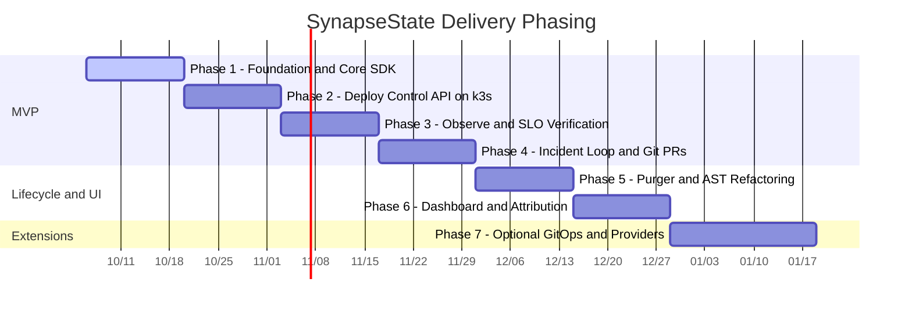

# Wayfinder Delivery Roadmap: SynapseState

> **Status:** Active Wayfinder Map (Post-Pivot v3.0)  
> **Guiding Charter:** [AGENTS.md](file:///c:/Users/adity/Desktop/Projects/SynapseState/AGENTS.md)  
> **Architecture Specification:** [docs/ARCHITECTURE.md](file:///c:/Users/adity/Desktop/Projects/SynapseState/docs/ARCHITECTURE.md)  
> **Product Definition:** [PRODUCT.md](file:///c:/Users/adity/Desktop/Projects/SynapseState/PRODUCT.md)  
> **Domain Glossary:** [GLOSSARY.md](file:///c:/Users/adity/Desktop/Projects/SynapseState/GLOSSARY.md)  
> **System Boundaries & Limitations:** [docs/limitations.md](file:///c:/Users/adity/Desktop/Projects/SynapseState/docs/limitations.md)

---

## 1. Destination

A production-grade, self-hosted **incident-safety and lifecycle governance layer for OpenFeature** where Node.js microservices evaluate feature flags locally with zero network syscalls on the hot path, protected by signed, auto-expiring emergency overrides (break-glass leases) that reconcile to Git, and telemetry-driven, compiler-verified cleanup PRs for dead feature flags.

---

## 2. Notes

- **Core Ecosystem:** Pure TypeScript / Node.js monorepo (`packages/lease`, `packages/sdk`, `packages/cli`, `packages/conformance`, `apps/control-api`, `apps/purger`, `apps/dashboard`, `apps/demo-shop`).
- **Evaluation Strategy:** Delegated entirely to underlying OpenFeature providers (such as flagd in-process with file source, or plain JSON) wrapped via `OverrideProvider`.
- **State Synchronization:** Direct ETag long-polling (`wait=30s`) with in-memory caching from application SDKs to the Control API; no sidecars or Unix domain sockets.
- **Standing Preferences:** Safety over coverage, fail-static SDK behavior, evidence before claims, and strict kill criteria.
- **Skills Every Session Should Consult:** `wayfinder`, `test-driven-development`, `verification-before-completion`, `codebase-design`.

---

## 3. Decisions So Far

- [ADR 0000: Record of Pre-Pivot Architectural Rejections](file:///c:/Users/adity/Desktop/Projects/SynapseState/docs/adr/0000-pre-pivot-architectural-rejections.md): Formally documents the rejection of POSIX shared memory (`mmap`), in-pod Go sidecars, Unix domain sockets, and custom rollout DSLs.
- [ADR 0001: Delegate Evaluation to Existing OpenFeature Providers](file:///c:/Users/adity/Desktop/Projects/SynapseState/docs/adr/0001-delegate-evaluation-to-openfeature.md): Sits atop standard OpenFeature providers via `OverrideProvider` wrapper rather than building a custom evaluator or rollout DSL.
- [ADR 0002: TypeScript Monorepo Unification](file:///c:/Users/adity/Desktop/Projects/SynapseState/docs/adr/0002-typescript-monorepo-unification.md): Unified single-language ecosystem across SDK, CLI, Control API, Purger, and Next.js Dashboard with zero native C dependencies.
- [ADR 0003: ETag Long-Polling for State Delivery and Air-Gapped Fallback](file:///c:/Users/adity/Desktop/Projects/SynapseState/docs/adr/0003-etag-long-polling-for-state-delivery.md): Direct SDK long-polling with `GET /v1/sdk/state?wait=30s` (dropping idle load 83% while delivering <100ms updates) and air-gapped `/etc/synapse/emergency-leases/` ConfigMap fallback.
- [ADR 0004: Operator-Signed Leases with Pluggable Signer, Pinned Keyset, and Bounded Caching](file:///c:/Users/adity/Desktop/Projects/SynapseState/docs/adr/0004-operator-signed-leases-with-pluggable-signer-and-pinned-keyset.md): Leases signed with operator Ed25519 keys via pluggable `Signer` (`EncryptedKeyfileSigner` default), validated against Git-pinned keyset with 10s hash polling, signed key revocations, 15m bounded fallback cache, and dual-clock auto-expiry.
- [ADR 0005: In-Process Audit Sealer with Transaction Locks and Isolated Checkpointer](file:///c:/Users/adity/Desktop/Projects/SynapseState/docs/adr/0005-in-process-audit-sealer-and-isolated-checkpointer.md): In-process sealer inside `control-api` using `pg_try_advisory_xact_lock` (PgBouncer-safe); seal order defines `seq`; checkpoint signer isolated to an independent Kubernetes CronJob.
- [ADR 0006: Read-Only Scanner and Per-Flag Consumer Coverage for Code Retirement](file:///c:/Users/adity/Desktop/Projects/SynapseState/docs/adr/0006-read-only-scanner-for-code-retirement.md): Read-only AST scanner and candidate qualifier in `synapse-purger`; per-flag evaluated consumer coverage with service retirement; zero untrusted code execution.
- [ADR 0007: Per-Flag Directory Storage and Pull-Based Incident Attribution](file:///c:/Users/adity/Desktop/Projects/SynapseState/docs/adr/0007-per-flag-storage-and-pull-based-attribution.md): Per-flag file storage `flags/<env>/<flag_key>.yaml` with build-time merge for single-file delegates; pull-based `synapse log` attribution powered by shared pure ranker `rankSuspects` and type-aware suggestions.

---

## 4. Delivery Phasing & Gantt Map

Estimates assume part-time engineering (10 to 15 focused hours per week).



---

## 5. Frontier & Phased Milestones

### Phase 1: Cryptographic Foundation & In-Process SDK (Weeks 1 – 2)

**Deliverable:** Monorepo scaffolding, CI pipelines, `packages/lease`, `packages/sdk`, and language-neutral conformance suite.

- **1.1 Monorepo Workspace & Build Scaffolding (`packages/*`, `apps/*`):** `[COMPLETED]`
  - Configured pnpm workspaces for shared dependencies and TypeScript project references.
  - Established GitHub Actions CI: linting, formatting (`prettier`), type-checking, and unit tests across all workspace packages.
- **1.2 Cryptographic Lease Core (`packages/lease`):** `[COMPLETED]`
  - Deterministic RFC 8785 JSON canonicalization (`canonicalizeJson` implemented).
  - Ed25519 signing and verification with domain separation (`"synapsestate/lease/v1\n"`, `"synapsestate/revocation/v1\n"`, and `"synapsestate/keyrevocation/v1\n"`).
  - Dual-clock expiration validation logic: $\min(\text{wall\_expiry}, \text{mono\_expiry})$ with process-scoped monotonic lifetime.
  - Pinned keyset Zod schema and parser.
- **1.3 OpenFeature In-Process SDK (`packages/sdk`):** `[COMPLETED]`
  - `OverrideProvider`: Implements OpenFeature `Provider` interface; wraps any delegate provider.
  - In-memory verified lease map with thread-safe pointer references.
  - Keyset hot-reload: 10s file-hash polling on mounted ConfigMap volume; bounded in-memory fallback cache (15-minute staleness ceiling); valid empty JSON `{}` acts as "revoke all".
  - Air-gapped emergency directory scanner: loads signed leases from `/etc/synapse/emergency-leases/`.
  - ETag long-polling client loop (`GET /v1/sdk/state?wait=30s`).
  - Fail-safe exception shielding: any internal error catches, increments metrics, and delegates to the underlying provider.
  - `TelemetryHook`: Zero-context `after`/`finally` hook recording `(flag_key, variant, reason)` with 5-minute flush interval and sorted keys.
- **1.4 Golden Test Conformance Suite (`packages/conformance`):** `[COMPLETED]`
  - Language-neutral test vectors covering valid signatures, tampered payloads, unknown `kid`, wall-clock expiry, monotonic expiry, future-dating, clock-skew tolerance, keyfile encryption format (scrypt + AES-256-GCM + AAD), keyset reload eviction, and sealer concurrency/seal order.
  - Initial OpenFeature and cryptographic compatibility spike verified in `packages/conformance/src/compatibility.test.ts`.
- **Recommended Branches & Pull Requests:**
  - **PR 1 (`feat/lease-crypto-schemas`):** `[COMPLETED]` `feat(lease): implement Zod schemas, Ed25519 sign/verify, and dual-clock expiry` — `packages/lease/src/{schema.ts, crypto.ts, expiry.ts, keyset.ts, index.ts}`
  - **PR 2 (`feat/conformance-golden-vectors`):** `[COMPLETED]` `test(conformance): language-neutral test vectors and JSON runner` — `packages/conformance/fixtures/*.json`, `packages/conformance/src/runner.ts`
  - **PR 3 (`feat/sdk-override-provider`):** `[COMPLETED]` `feat(sdk): implement OverrideProvider, keyset watcher, and emergency directory scanner` — `packages/sdk/src/{provider.ts, lease-store.ts, keyset-watcher.ts, emergency-scanner.ts}`
  - **PR 4 (`feat/sdk-long-poll-telemetry`):** `[COMPLETED]` `feat(sdk): ETag long-polling client loop and zero-context TelemetryHook` — `packages/sdk/src/{state-client.ts, telemetry-hook.ts, ulid.ts, index.ts}`
  - **PR 5 (`perf/sdk-microbenchmarks`):** `[COMPLETED]` `perf(sdk): microbenchmarks measuring OverrideProvider overhead vs bare delegate` — `packages/sdk/benchmarks/*`
- **Security & Best Practice Review Checkpoints:** `[AUDITED & VERIFIED]`
  - **Cryptographic Invariants:** Verify RFC 8785 canonicalization compliance (key sorting, whitespace, float serialization). Confirm Ed25519 uses `null` digest algorithm. Validate exact domain separation prefixes (`"synapsestate/lease/v1\n"`, `"synapsestate/revocation/v1\n"`, `"synapsestate/keyrevocation/v1\n"`).
  - **Fail-Safe Hot Path (Invariant 1):** Audit every `resolve*Evaluation` branch; wrap all lookup and crypto operations in `try/catch` with automatic delegation to the underlying provider on error.
  - **Zero-Context Telemetry (Invariant 5):** Static analysis confirming `hookContext.context` is never read, accessed, or exported.
  - **Pinned Keyset Trust Root (Invariant 2):** Confirm SDK validates signatures strictly against locally mounted keyset; reject any key material originating from the Control API.
- **Definition of Done:** 100% green CI; full conformance vector coverage; zero dependencies on native C/Rust binaries.

---

### Phase 2: Deployment & Infrastructure as Code (Weeks 3 – 4)

**Deliverable:** Control API + PostgreSQL deployed on k3s via Terraform and Helm; container images published to GHCR.

- **2.1 Control Plane Service (`apps/control-api`):** `[COMPLETED]`
  - Express/Fastify service in TypeScript connected to PostgreSQL 16.
  - `GET /v1/time`: server time synchronization endpoint.
  - `POST /v1/leases`: soft reference validation (no blocking FK/registry check; emits `UNKNOWN_FLAG` warning), inserts into `leases`, `audit_pending`, and `change_events`.
  - `GET /v1/sdk/state`: long-polling endpoint with `?wait=30s`, serving in-memory cached ETags and token hashes; returns bounded revocations (`expires_at >= now`).
  - `GET /v1/changes`: change-event feed supporting pull-based `synapse log` and incident investigation.
  - `POST /v1/telemetry/batches`: idempotent batch ingestion served via an isolated connection pool with 429/503 load shedding.
- **2.2 In-Process Asynchronous Audit Sealer:** `[COMPLETED]`
  - Background loop running inside `control-api` protected by `pg_try_advisory_xact_lock(hashtext('synapse_audit_sealer'))` per transaction (safe with PgBouncer).
  - Self-rescheduling `setTimeout` with in-flight guard, batch size capped at 100, `try/catch` wrapper, graceful SIGTERM handling, and `synapse_audit_pending_age_seconds` metric.
- **2.3 Infrastructure as Code (`deploy/terraform`):** `[COMPLETED]`
  - Terraform configuration provisioning a single lightweight cloud VM, security groups, firewall rules, and DNS records.
  - Remote state with state locking; `terraform fmt`, `validate`, and `plan` running in CI.
  - Automated `make teardown` target for cost management.
- **2.4 Kubernetes Packaging & Isolated Checkpoint Signer (`deploy/helm`):** `[COMPLETED]`
  - Helm charts deploying Control API and Postgres on k3s.
  - Independent Kubernetes CronJob (`synapse-checkpoint-signer`) with isolated credentials and write-only IAM role to external S3 Object Lock / protected Git branch.
  - Pod security standards: read-only root filesystems, non-root users, dropped capabilities.
  - Ingress routing with TLS termination via cert-manager.
- **Recommended Branches & Pull Requests:**
  - **PR 6 (`feat/control-api-db-schema`):** `[COMPLETED]` `feat(api): postgres migrations, connection pool isolation, and transaction helpers` — `apps/control-api/src/db/{migrations/*, pool.ts}`
  - **PR 7 (`feat/control-api-state-delivery`):** `[COMPLETED]` `feat(api): time sync, lease ingestion, and ETag long-polling state endpoint` — `apps/control-api/src/routes/{time.ts, leases.ts, state.ts}`
  - **PR 8 (`feat/control-api-audit-sealer`):** `[COMPLETED]` `feat(api): in-process audit sealer with postgres advisory transaction lock` — `apps/control-api/src/sealer/{sealer.ts, chain.ts}`
  - **PR 9 (`feat/control-api-telemetry-changes`):** `[COMPLETED]` `feat(api): bulkhead telemetry batch endpoint and change-event feed` — `apps/control-api/src/routes/{telemetry.ts, changes.ts}`
  - **PR 10 (`infra/docker-packaging`):** `[COMPLETED]` `ci(docker): multi-stage distroless Dockerfiles and GHCR image publishing` — `Dockerfile.control-api`, `Dockerfile.demo-shop`, `.github/workflows/docker.yml`
  - **PR 11 (`infra/terraform-k3s-helm`):** `[COMPLETED]` `infra(deploy): terraform VM provisioning and Helm charts for k3s` — `deploy/terraform/*`, `deploy/helm/*`
- **Security & Best Practice Review Checkpoints:** `[AUDITED & VERIFIED]`
  - **SQL Injection & Connection Safety:** Audited parameterized queries across all routes (`apps/control-api/src/routes/*`, `apps/control-api/src/db/*`). Strict pool isolation between `leasePool` (20 connections) and `telemetryPool` (5 connections) prevents telemetry bulk flushes from starving critical lease CRUD or ETag state delivery.
  - **Concurrency & Advisory Lock Safety:** Transaction-level advisory locking via `pg_try_advisory_xact_lock(hashtext('synapse_audit_sealer'))` verified across single transactions; compatible with PgBouncer transaction-mode pooling without lock leaks across re-used connections.
  - **Container & Pod Hardening:** Hardened distroless non-root execution (`runAsUser: 65532`, `runAsGroup: 65532`, `runAsNonRoot: true`), `readOnlyRootFilesystem: true`, `allowPrivilegeEscalation: false`, dropped capabilities (`capabilities: { drop: ["ALL"] }`), and `seccompProfile: { type: RuntimeDefault }` across all Helm deployment templates and CronJobs.
  - **Secret Management & Trust Root Separation:** Zero cleartext secrets in Git. Database credentials and signing keys injected exclusively via Kubernetes Secrets (`secretKeyRef`). Pinned Keyset (`synapse-keyset`) and emergency leases volumes are decoupled from Helm release lifecycle and managed out-of-band via GitOps (ARCH §3.1, Invariant 2).
  - **Cloud VM & Checkpoint Anchoring Isolation:** Terraform provisions single-node k3s with IMDSv2 enforced (`http_tokens = "required"`), fail-closed firewall rules (`allowed_ssh_cidrs = []`, `allowed_k8s_api_cidrs = []`), pinned k3s version (`v1.30.5+k3s1`), `--write-kubeconfig-mode 600`, and immutable S3 Object Lock in `COMPLIANCE` mode with write-only IAM policy denying object deletion (ARCH §8.3).
- **Definition of Done:** 100% green CI; distroless container publishing to GHCR (`docker.yml`); Terraform VM provisioning with automated `make teardown` target; modular Helm charts linted and template-tested with zero errors (`infra.yml`).

---

### Phase 3: Observability, Metrics & SLO Verification (Weeks 5 – 6)

**Deliverable:** Prometheus metrics, Grafana dashboards, OpenTelemetry traces, multi-window burn-rate alerts, and k6 load verification.

- **3.1 Metrics Instrumentation:** `[COMPLETED]`
  - Control API Prometheus metrics: `synapse_leases_active`, `synapse_lease_transitions_total`, `synapse_state_poll_duration_seconds`, `synapse_audit_pending_queue_size`, `synapse_audit_pending_age_seconds`, `synapse_audit_chain_length`.
  - SDK metrics callback: `synapse_sdk_state_age_seconds`, `synapse_sdk_keyset_age_seconds`, `synapse_sdk_poll_errors_total`, `synapse_sdk_telemetry_dropped_total`.
- **3.2 Grafana Dashboards & Alert Rules:** `[COMPLETED]`
  - Operations dashboard tracking active leases, TTL countdowns, and propagation lag.
  - Alertmanager multi-window burn-rate alert rules on state availability and propagation lag.
- **3.3 Load & Stress Benchmarking (`load/k6`):** `[COMPLETED]`
  - k6 load test simulating 100 concurrent SDK long-polling instances and telemetry flushes.
  - Identify first saturation bottleneck and publish documented limits.
- **Recommended Branches & Pull Requests:**
  - **PR 12 (`feat/metrics-control-api-sdk`):** `[COMPLETED]` `feat(obs): prometheus metrics in control-api and SDK callbacks` — `apps/control-api/src/metrics/*`, `packages/sdk/src/metrics.ts`
  - **PR 13 (`obs/dashboards-and-alerts`):** `[COMPLETED]` `obs(grafana): operations dashboard and alertmanager multi-window alert rules` — `deploy/helm/dashboards/*`, `deploy/helm/alerts/*`
  - **PR 14 (`test/load-k6-benchmarks`):** `[COMPLETED]` `test(load): k6 long-polling load harness and documented saturation limits` — `load/k6/*`
- **Security & Best Practice Review Checkpoints:** `[AUDITED & VERIFIED]`
  - **Metric Cardinality Audit:** Audited all Prometheus metric instruments across Control API and SDK (`metrics.ts`). Enforced strict bounded label dimensions (`env`, `status_code`, `reason`, `from`, `to`). Prohibited high-cardinality user IDs, targeting keys, and lease IDs. Per-lease TTL countdown is deliberately omitted from Prometheus series to protect scraper/storage stability, directing operators to `synapse lease list`.
  - **Multi-Window Multi-Burn-Rate Verification:** Mathematically verified Alertmanager SLO rules (14.4x 1h/5m fast burn, 6x 6h/30m slow burn) against Google SRE alerting standards for a 99.5% availability target ($0.5\%$ error budget). Enforced traffic floor guards (`> 0.03 req/s`) on all multi-burn alerts to prevent false-positive flapping during 304 quiet long-poll intervals.
  - **Fail-Safe Hot Path & Scrape Throttling:** The `/metrics` endpoint is strictly fail-open: database connectivity blips log a warning and return HTTP 200 with in-memory metrics without failing the scrape. A 5-second database query cache throttle (`REFRESH_THROTTLE_MS = 5000`) prevents denial-of-service from aggressive scraping. SDK metric callbacks execute inside defensive try/catch wrappers to guarantee zero impact on evaluation hot paths.
  - **Zero-Context Telemetry & Bulkhead Integrity:** Telemetry ingestion (`POST /v1/telemetry/batches`) enforces Invariant 5 by accepting only `(flag_key, variant, reason, count)` tuples. Load-testing harnesses generate zero-context synthetic batches without injecting user attributes or polluting production propagation lag histograms. Connection pool bulkhead (`leasePool` 20 vs `telemetryPool` 10) guarantees that telemetry saturation sheds load via HTTP 429 without starving emergency state delivery.
  - **Chart Drift & Operational Runbooks:** Automated conformance test (`observability.test.ts`) verifies byte-identical synchronization between root Helm dashboard/alert definitions and chart templates. Linked every firing alert to an actionable in-tree runbook under `docs/runbooks/`.
- **Definition of Done:** Verified Grafana operations dashboard (`synapsestate-operations.json`); Alertmanager multi-window rules with traffic floor filters (`synapsestate-rules.yaml`); published SLO verification report (`docs/benchmarks/load-test-report.md`) with measured numbers ($p95 \text{ propagation} = 0.462\text{s} \le 10\text{s}$, $0.00\%$ long-poll drops, $4,108\text{ evals/s}$ telemetry throughput).

---

### Phase 4: Incident Break-Glass Loop & Git Reconciliation (Weeks 7 – 8)

**Deliverable:** SRE CLI tool, Git PR promotion loop, tamper-evident audit ledger with external anchoring, and scripted failure drills.

- **4.1 Command-Line Interface (`packages/cli`):** `[COMPLETED]`
  - Pluggable `Signer` interface with `EncryptedKeyfileSigner` default (`~/.synapse/keys/<kid>.key`, AES-256-GCM + scrypt + AAD, 0600 POSIX permissions).
  - `synapse key generate` & `synapse key export-public`: mechanical on-call keypair creation and keyset PR export.
  - `synapse lease create`: syncs time with `GET /v1/time`, signs locally with operator Ed25519 key, posts to API, warns on unknown flag, and runs live rollout verification loop (`applied by X/Y instances, N override evaluations`).
  - `synapse lease emergency-apply`: generates ConfigMap YAML for direct `kubectl apply` air-gapped override.
  - `synapse lease list`: tabular display of active leases and remaining TTL.
  - `synapse lease revoke`: issues signed revocation message.
  - `synapse log`: pull-based incident investigation (`--service <name> [--since 30m] [--offline] [--json]`) powered by pure `rankSuspects` function with type-aware mitigation suggestions.
  - `synapse promote`: triggers Git reconciliation PR targeting `flags/<env>/<flag_key>.yaml` with stale PR conflict detection (scoped to Git-backed providers in v1).
  - `synapse audit verify`: recomputes hash chain from genesis against external checkpoints.
  - `synapse audit checkpoint`: signs periodic external audit checkpoints with isolated key.
- **4.2 Git Reconciliation & Dual-Control Promotion:** `[COMPLETED]`
  - GitHub App integration: opens PR on `flags/<env>/<flag_key>.yaml` when an operator promotes a lease.
  - Human peer review and merge of the PR serves as formal secondary approval.
  - GitHub merge webhook transitions lease to `PROMOTED` and emits revocation.
- **4.3 External Checkpoint Anchoring:** `[COMPLETED]`
  - Isolated Kubernetes CronJob signs periodic checkpoints of the sealed audit chain to an external write-once store.
- **4.4 Reliability & Chaos Drills:** `[COMPLETED]`
  - Drill 1: Kill Control API during active incident -> apply override via `kubectl apply` air-gapped ConfigMap -> verify workload enforcement.
  - Drill 2: Clock-skew injection -> verify monotonic expiry enforcement per process.
  - Drill 3: Network partition during revocation -> verify bounded exposure to `expires_at`.
  - Drill 4: Write one formal postmortem report in `docs/postmortems/`.
- **Recommended Branches & Pull Requests:**
  - **PR 15 (`feat/cli-signer-and-keys`):** `[COMPLETED]` `feat(cli): EncryptedKeyfileSigner and key management commands` — `packages/cli/src/signer/*`, `packages/cli/src/commands/key.ts`
  - **PR 16 (`feat/cli-lease-lifecycle`):** `[COMPLETED]` `feat(cli): lease create, rollout status polling, and emergency-apply` — `packages/cli/src/commands/lease.ts`
  - **PR 17 (`feat/cli-incident-log-ranker`):** `[COMPLETED]` `feat(cli): synapse log incident investigation with pure rankSuspects` — `packages/cli/src/commands/log.ts`, `packages/cli/src/ranker.ts`
  - **PR 18 (`feat/git-promotion-reconciliation`):** `[COMPLETED]` `feat(api): GitHub App PR promotion and merge webhook reconciliation` — `apps/control-api/src/github/*`, `packages/cli/src/commands/promote.ts`
  - **PR 19 (`feat/audit-checkpoint-verifier`):** `[COMPLETED]` `feat(cli): isolated checkpoint signer CronJob and synapse audit verify` — `deploy/helm/cronjobs/*`, `packages/cli/src/commands/audit.ts`
  - **PR 20 (`test/chaos-drills-and-postmortem`):** `[COMPLETED]` `docs(postmortem): scripted 90-second demo and chaos injection drill results` — `docs/postmortems/*`, `test/drills/*`
- **Security & Best Practice Review Checkpoints:** `[AUDITED & VERIFIED]`
  - **Key Storage Threat Model:** `[AUDITED & VERIFIED]` Verified AES-256-GCM encryption with `crypto.scrypt` (`N=32768, r=8, p=1`), AAD binding to `kid` and format version, and POSIX file permission enforcement (`0600`) on `~/.synapse/keys/*.key`.
  - **Git Dual-Control Approval (Invariant 4):** `[AUDITED & VERIFIED]` Verify `synapse promote` opens Draft PRs only; automated direct-to-main merges are strictly prohibited. Peer review serves as secondary approval.
  - **Audit Chain Integrity (Invariant 7):** `[AUDITED & VERIFIED]` Verify `synapse audit verify` recomputes SHA-256 hashes from genesis independently rather than trusting database-stored hashes.
- **Definition of Done:** Scripted 90-second demo executable end-to-end; one written postmortem from a deliberate failure drill.

---

### Phase 5: Telemetry Qualification & Codebase Scanner (`apps/purger`) (Weeks 9 – 10)

**Deliverable:** Read-only AST scanner, per-flag consumer qualification engine, and structured candidate reports.

- **5.1 Quiescence & Candidate Qualification Engine:** `[COMPLETED]`
  - SQL rollup jobs scanning `flag_usage_daily` and `services`.
  - Candidate rule: `class = release`, single variant for 35–45 days, 100% of evaluating consumer services `ACTIVE` or `RETIRED`, zero active leases.
- **5.2 Read-Only TypeScript Scanner (`apps/purger`):** `[COMPLETED]`
  - Parse repository via `ts-morph` from `tsconfig.json`.
  - Identify literal string key evaluations (`getBooleanValue('literal-key', defaultVal)`).
  - Cross-reference AST consumer references against runtime evaluated services.
  - Zero untrusted code execution: never runs `npm test` or build scripts inside the container.
- **5.3 Structured Candidate & Refusal Reports:** `[COMPLETED]`
  - Output GitHub Issues or CLI reports with exact `(flag_key, winning_variant)` tuples and line numbers, ready for Piranha, GritQL, or manual PRs.
- **Recommended Branches & Pull Requests:**
  - **PR 21 (`feat/purger-quiescence-engine`):** `[COMPLETED]` `feat(purger): stale flag candidate qualification SQL rollups` — `apps/purger/src/qualification/*`
  - **PR 22 (`feat/purger-ts-morph-scanner`):** `[COMPLETED]` `feat(purger): read-only ts-morph AST scanner and caller indexing` — `apps/purger/src/scanner/*`
  - **PR 23 (`feat/purger-candidate-reports`):** `[COMPLETED]` `feat(purger): candidate extraction and refusal report generation` — `apps/purger/src/reports/*`
- **Security & Best Practice Review Checkpoints:** `[AUDITED & VERIFIED]`
  - **Untrusted Code Execution Boundary (Invariant 6):** Ensure `apps/purger` operates as a read-only AST parser; verify zero execution of `npm test`, `eval()`, or repository build scripts while holding GitHub credentials.
  - **Refusal by Default:** Verify that any non-literal string argument (ternaries, variables, dynamic lookups) triggers an explicit Refusal Report rather than heuristic guesswork.
- **Definition of Done:** Zero incorrect candidate qualifications on labeled corpus; published refusal and candidate reports.

---

### Phase 6: Operations Dashboard & Optional Push Automation (Weeks 11 – 12)

**Deliverable:** Next.js read-mostly dashboard with OIDC RBAC, optional Alertmanager change attribution webhook, and polished documentation.

- **6.1 Next.js Operations Dashboard (`apps/dashboard`):** `[COMPLETED]`
  - Read-mostly interface displaying active leases, countdown timers, flag inventory, and telemetry rollups.
  - GitHub OIDC authentication with roles (`viewer`, `operator`, `admin`).
  - Safety boundary: Dashboard can promote or revoke, but **cannot create leases** (signing keys reside on operator machines).
- **6.2 Push Incident Automation (Optional Extension):** `[COMPLETED]`
  - Optional webhook listener calling shared `rankSuspects` and `GET /v1/changes`.
  - Automatically creates Grafana annotations and suggests copy-pasteable `synapse lease create` commands in incident channels.
- **Recommended Branches & Pull Requests:**
  - **PR 24 (`feat/dashboard-nextjs-portal`):** `[COMPLETED]` `feat(dashboard): read-mostly operations portal with OIDC authentication` — `apps/dashboard/*`
  - **PR 25 (`feat/dashboard-rbac-and-actions`):** `[COMPLETED]` `feat(dashboard): RBAC controls and lease promotion/revocation triggers` — `apps/dashboard/src/auth/*`, `apps/dashboard/src/api/*`
  - **PR 26 (`feat/push-incident-webhook`):** `[COMPLETED]` `feat(api): optional alertmanager incident webhook and grafana annotations` — `apps/control-api/src/webhooks/*`
- **Security & Best Practice Review Checkpoints:** `[AUDITED & VERIFIED]`
  - **Signing Key Air-Gap:** Ensure the dashboard backend has no access to operator private keys and cannot sign emergency leases.
  - **OIDC RBAC Audit:** Validate role enforcement (`viewer`, `operator`, `admin`), CSRF token protection, and secure cookie flags (`HttpOnly; Secure; SameSite=Strict`).
- **Definition of Done:** Deployed, clickable dashboard linked from README; end-to-end incident attribution demonstrated.

---

### Phase 7: End-to-End Verification & Mutation Resilience (Weeks 13 – 14)

**Deliverable:** Playwright browser test suite for the Operations Portal, Stryker mutation testing for cryptographic/safety boundaries, and automated CI chaos drills. Reference: [docs/ADVANCED_TESTING_HANDOFF.md](file:///c:/Users/adity/Desktop/Projects/SynapseState/docs/ADVANCED_TESTING_HANDOFF.md).

- **7.1 Dashboard End-to-End Test Suite (`apps/dashboard/e2e`):**
  - Full Playwright user journeys against production builds (`next build && next start` on port 3010).
  - RBAC permission enforcement: verify `viewer` cannot trigger mutations; `operator` and `admin` execute valid actions.
  - Real-time countdown timer testing: monotonic decrement and dual-clock expiry visual updates.
  - Revocation and Promotion modal execution with YAML diff preview and toast confirmation.
- **7.2 Cryptographic & Invariant Mutation Testing (`packages/lease` & `packages/sdk`):**
  - Granular Stryker Mutator configuration (`@stryker-mutator/core` + `@stryker-mutator/vitest-runner`) with `related: true`.
  - Enforce mutation testing against core invariants:
    - Invariant 3: Dual-clock expiry arithmetic ($\min(\text{mono}, \text{wall})$ and skew tolerance).
    - Invariant 1: Fail-safe fallback try/catch delegation to base provider.
    - Invariant 2: Ed25519 signature verification, RFC 8785 canonicalization, and SHA-256 hash chaining.
  - Enforce Mutation Score Indicator (MSI) break threshold $\ge 80\%$.
- **7.3 Automated Chaos & Fault-Injection Pipeline:**
  - Automated execution of the 3 chaos failure drills (`test/drills/`) in CI against live Docker environments (API partition, host clock-skew injection, and revocation packet loss).
- **Recommended Branches & Pull Requests:**
  - **PR 27 (`test/dashboard-playwright-e2e`):** `test(dashboard): Playwright E2E suite for RBAC, active leases, and promotion flows` — `apps/dashboard/e2e/*`
  - **PR 28 (`test/mutation-stryker-invariants`):** `test(lease,sdk): Stryker mutation testing for cryptographic and dual-clock invariants` — `packages/lease/stryker.config.json`, `packages/sdk/stryker.config.json`
  - **PR 29 (`test/chaos-drill-automation`):** `test(drills): automated CI runner and assertions for network partitions and clock-skew drills` — `test/drills/*`, `.github/workflows/*`
- **Security & Best Practice Review Checkpoints:**
  - **Production Build Only:** Ensure Playwright tests run against production `next start` server to avoid dev-server hydration jitter.
  - **Zero Surviving Invariant Mutants:** 100% of mutants touching dual-clock expiry and signature checks must be killed.
- **Definition of Done:** 100% Playwright test pass rate; Stryker Mutation Score $\ge 80\%$ on `packages/lease` and `packages/sdk`; 3/3 chaos drills passing in CI.

---

### Phase 8: Production Load Saturation, Soak Benchmarks & Observability Visuals (Weeks 15 – 16)

**Deliverable:** 10-minute soak testing, saturation cliff identification, bulkhead load-shedding proof, and automated headless screenshot capture during live load. Reference: [docs/LOAD_TESTING_AND_OBSERVABILITY_HANDOFF.md](file:///c:/Users/adity/Desktop/Projects/SynapseState/docs/LOAD_TESTING_AND_OBSERVABILITY_HANDOFF.md).

- **8.1 Multi-Scenario k6 Saturation & Soak Harness (`load/k6/`):**
  - Standardized 4-phase Story Arc traffic orchestration: Baseline $\to$ Emergency Break-Glass $\to$ Telemetry Bulkhead Saturation $\to$ Ephemeral Expiry.
  - 10-minute sustained soak test to verify Node.js memory RSS stability under continuous long-polling.
- **8.2 Bulkhead Isolation & Load-Shedding Verification:**
  - Empirical proof under 5,000+ evals/s that telemetry saturation sheds load (HTTP 429 on `telemetryPool`) while state delivery (`leasePool`) maintains 100% availability and $<10\text{ms}$ latency.
- **8.3 Automated Observability Screenshot Pipeline:**
  - Automated headless browser capture of all 5 dashboards (Overview, Leases, Flags, Audit Ledger, Grafana) during live load for automated README and release asset generation.
- **Recommended Branches & Pull Requests:**
  - **PR 30 (`test/k6-soak-and-saturation`):** `test(load): 10-minute soak harness and saturation cliff benchmarks` — `load/k6/*`
  - **PR 31 (`ci/automated-dashboard-screenshots`):** `ci(docs): automated headless capture of operations portal and Grafana during live load scenarios` — `scratch/capture-dashboards.js`, `docs/assets/*`
- **Security & Best Practice Review Checkpoints:**
  - **Bulkhead Immunity:** Confirm zero connection starvation on `leasePool` during telemetry write spikes.
  - **Zero PII in Documentation Visuals:** Assert that captured dashboard screenshots contain only synthetic test personas.
- **Definition of Done:** Documented saturation cliff report; published Grafana and Next.js screenshots captured during active load testing; zero memory leaks over 10-minute soak.

---

## 6. Non-Negotiable Kill Criteria

To prevent scope creep and maintain strict project delivery:

1. **Infrastructure Over Features:** If Phase 2 (deployment on k3s via Terraform and Helm) is not live by the end of Week 4, stop adding features. If not live by Week 6, **cut the Dashboard and the Purger**. _Cut features, never infrastructure._
2. **Purger Safety Gate:** If `synapse-purger` cannot achieve **zero incorrect removals** on the labeled corpus, ship it as **report-only** (lists candidates and call sites, but opens zero code PRs).
3. **Sequential Focus:** No secondary project or optional phase may begin until Phase 4 is completely green and demonstrated.

---

## 7. Not Yet Specified (Fog of War)

These decisions represent in-scope areas that depend on earlier milestone learnings and will graduate to formal decision tickets as the frontier advances:

- **Open Question 1 (Metadata Reason Convention — Resolved):** Confirmed in `packages/conformance/src/compatibility.test.ts`. OpenFeature `ResolutionDetails.reason` accepts `"OVERRIDE"`, with override details namespaced under `flagMetadata["synapse.*"]` (`synapse.override`, `synapse.lease_id`, `synapse.issued_by`, `synapse.effective_expiry`).
- **Open Question 2 (TTL Bounds Calibration):** Establish the final default values for `MAX_TTL` (30m vs 60m) and `SKEW_TOLERANCE` (30s vs 60s) following initial clock-skew injection drills in Phase 3.
- **Open Question 3 (PostgreSQL K8s Packaging):** Decide in a dedicated ADR between deploying PostgreSQL via a standard Bitnami Helm chart versus the CloudNativePG Kubernetes operator on k3s.
- **Open Question 4 (Audit Checkpoint Anchor Target):** Select the permanent external anchoring target for signed audit checkpoints: an isolated, branch-protected Git repository branch vs. an S3 bucket with Object Lock enabled.
- **Open Question 5 (Cloud Provider Selection):** Select the specific cloud VM provider (e.g. Hetzner, AWS, GCP, Scaleway) based on current pricing and free-tier terms before provisioning Phase 2 Terraform manifests.

---

## 8. Out of Scope

Work ruled permanently beyond this destination; closed and excluded from the frontier:

- **Bespoke Kubernetes Operator / CRD for Flag Declarations:** Evaluating baseline flags or syncing manifests via a custom in-pod or in-cluster controller. Standard GitOps tools (ArgoCD, Flux) and native OpenFeature file/ConfigMap providers handle baseline synchronization declaratively.
- **Bespoke GitOps Controller Integration:** Maintaining custom synchronization agents; standard Git pull requests (`synapse promote`) cleanly interface with existing GitOps controllers without bespoke integration code.
- **Vendor-Specific In-Core Adapters:** Core SynapseState wraps any OpenFeature standard `Provider` interface generically (`new OverrideProvider({ delegate })`). Any OpenFeature-compliant provider (Unleash, Flipt, LaunchDarkly, flagd) works out-of-the-box without bespoke vendor adapters in core.
- **Custom Flag Evaluation Engine:** Building rule evaluation, context segmenters, or MurmurHash3 bucketing. Evaluation is strictly delegated to OpenFeature providers.
- **Client-Side / Mobile SDKs:** Browser, iOS, or Android SDK distribution. Internal keysets and rulesets never egress to untrusted environments.
- **Web Administrative Flag Authoring:** A web UI for creating or editing flag definitions. Git is the sole source of truth for baseline configurations.
- **In-Pod Sidecar Daemons & Sockets:** Injecting sidecar containers (`synapse-agent`) or maintaining UDS socket streaming in pods. SDKs poll the Control API directly over HTTPS with `ETag`.
- **Autonomous Direct-to-Master Code Merges:** The purger and promotion pipelines open Pull Requests only; direct merges without human review are prohibited.
- **Multi-Region / Multi-Cluster HA:** Operating multi-master geo-distributed control planes in v1.
- **Microbenchmark Theater:** Claiming unsubstantiated nanosecond latency records. We publish only measured wrapper overhead compared against bare delegate providers.

---

## 9. Scripted 90-Second Demo

1. **Baseline Operation:** The `demo-shop` application is running in k3s. Grafana shows steady transaction rates and zero 5xx errors.
2. **Trigger Incident:** Simulate a bad release merged behind flag `checkout-v2`. Latency spikes, and the Alertmanager burn-rate alert fires.
3. **Inspect Suspects:** The alert notification identifies `checkout-v2` as the top suspect change within the last 30 minutes.
4. **Issue Break-Glass Lease:**
   ```bash
   synapse lease create --flag checkout-v2 --env prod --value false --ttl 30m --reason "INC-142: High latency"
   ```
5. **Observe Recovery:** SDK polls state, verifies Ed25519 signature, and forces flag value to `false`. Grafana shows immediate error rate collapse.
6. **Promote to Git:**
   ```bash
   synapse promote <lease_id>
   ```
   Show the generated GitHub PR changing `checkout-v2` in `flags/prod/checkout-v2.yaml`.
7. **Verify Audit Chain:**
   ```bash
   synapse audit verify
   ```
   Confirm all transitions are cryptographically chained and match external checkpoints.

---

## 10. Engineering Portfolio & Competency Evidence Map

| Engineering Dimension       | Artifact & Implementation                                                              | Verifiable Proof                                 |
| --------------------------- | -------------------------------------------------------------------------------------- | ------------------------------------------------ |
| **CI/CD Automation**        | GitHub Actions: lint, test, conformance, Docker build, scan, Cosign signing, GHCR push | Green pipeline runs, signed release assets       |
| **Containerization**        | Multi-stage Dockerfiles with pinned distroless bases; `docker compose`                 | Single-command local developer environment       |
| **Cloud & IaC**             | Terraform: VM, security groups, firewall, DNS, S3 remote state                         | Committed Terraform plans, live HTTPS endpoint   |
| **Kubernetes**              | Helm chart on k3s, Traefik ingress, cert-manager TLS, NetworkPolicies                  | Manifests, running cluster workloads             |
| **Observability**           | Prometheus metrics, Grafana dashboards, OpenTelemetry spans                            | Dashboard screenshots, firing alert recordings   |
| **Reliability Engineering** | Documented SLOs, k6 load testing, clock-skew injection drills, postmortem              | Production-grade writeups in `docs/postmortems/` |
| **Supply-Chain Security**   | Trivy vulnerability scanning, CycloneDX SBOMs, Cosign keyless signatures               | CI logs, signed image provenance                 |
