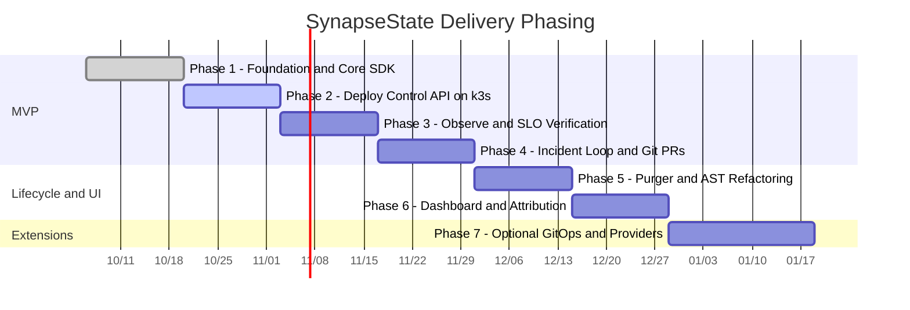

# Wayfinder Delivery Roadmap: SynapseState

> **Status:** Active Wayfinder Map (Post-Pivot v3.0)  
> **Guiding Charter:** [AGENTS.md](file:///c:/Users/adity/Desktop/Projects/SynapseState/AGENTS.md)  
> **Architecture Specification:** [docs/ARCHITECTURE.md](file:///c:/Users/adity/Desktop/Projects/SynapseState/docs/ARCHITECTURE.md)  
> **Product Definition:** [PRODUCT.md](file:///c:/Users/adity/Desktop/Projects/SynapseState/PRODUCT.md)  
> **Domain Glossary:** [GLOSSARY.md](file:///c:/Users/adity/Desktop/Projects/SynapseState/GLOSSARY.md)  
> **System Boundaries & Limitations:** [docs/limitations.md](file:///c:/Users/adity/Desktop/Projects/SynapseState/docs/limitations.md)

---

## 1. Destination

A production-grade, self-hosted **incident-safety and lifecycle governance layer for OpenFeature** where Node.js microservices evaluate feature flags locally with zero network syscalls on the hot path, protected by signed, auto-expiring emergency overrides (break-glass leases) that reconcile to Git, and telemetry-driven, compiler-verified cleanup PRs for dead feature flags.

---

## 2. Notes

* **Core Ecosystem:** Pure TypeScript / Node.js monorepo (`packages/lease`, `packages/sdk`, `packages/cli`, `packages/conformance`, `apps/control-api`, `apps/purger`, `apps/dashboard`, `apps/demo-shop`).
* **Evaluation Strategy:** Delegated entirely to underlying OpenFeature providers (such as flagd in-process with file source, or plain JSON) wrapped via `OverrideProvider`.
* **State Synchronization:** Direct HTTP polling with `ETag` conditional caching (5s interval with jitter) from application SDKs to the Control API; no sidecars or Unix domain sockets.
* **Standing Preferences:** Safety over coverage, fail-static SDK behavior, evidence before claims, and strict kill criteria.
* **Skills Every Session Should Consult:** `wayfinder`, `test-driven-development`, `verification-before-completion`, `codebase-design`.

---

## 3. Decisions So Far

* [ADR 0005: Delegate Evaluation to Existing OpenFeature Providers](file:///c:/Users/adity/Desktop/Projects/SynapseState/docs/adr/0005-delegate-evaluation-to-existing-openfeature-providers.md): Sits atop standard OpenFeature providers via `OverrideProvider` wrapper rather than building a custom evaluator or rollout DSL.
* [ADR 0006: HTTP Polling with ETag over In-Pod Sidecar IPC](file:///c:/Users/adity/Desktop/Projects/SynapseState/docs/adr/0006-http-polling-with-etag-over-sidecar-ipc.md): Direct SDK polling with conditional `304 Not Modified` caching replaces mutating webhooks, sidecar daemons (`synapse-agent`), and intra-pod UDS sockets.
* [ADR 0007: Operator-Signed Leases with Pinned Keyset and Git Promotion](file:///c:/Users/adity/Desktop/Projects/SynapseState/docs/adr/0007-operator-signed-leases-with-pinned-keyset-and-git-promotion.md): Leases signed with operator Ed25519 keys and validated against a Git-pinned keyset; GitHub PR review serves as dual-control second approval.
* [ADR 0008: TypeScript Monorepo Unification](file:///c:/Users/adity/Desktop/Projects/SynapseState/docs/adr/0008-typescript-monorepo-unification.md): Unified single-language ecosystem across SDK, CLI, Control API, Purger, and Next.js Dashboard.
* [ADR 0009: Refusal-by-Default AST Refactoring for Code Retirement](file:///c:/Users/adity/Desktop/Projects/SynapseState/docs/adr/0009-refusal-by-default-ast-refactoring-for-code-retirement.md): Safety-first `ts-morph` refactoring for literal keys with Refusal Reports and pre-flight compiler (`tsc --noEmit`), linter, and test checks.

---

## 4. Delivery Phasing & Gantt Map

Estimates assume part-time engineering (10 to 15 focused hours per week).



---

## 5. Frontier & Phased Milestones

### Phase 1: Cryptographic Foundation & In-Process SDK (Weeks 1 – 2)
**Deliverable:** Monorepo scaffolding, CI pipelines, Dockerfiles, `packages/lease`, `packages/sdk`, and language-neutral conformance suite.

* **1.1 Monorepo Workspace & Build Scaffolding (`packages/*`, `apps/*`):**
  * Configure npm/pnpm workspaces for shared dependencies and TypeScript project references.
  * Establish GitHub Actions CI: linting, formatting (`prettier`), type-checking, and unit tests.
* **1.2 Cryptographic Lease Core (`packages/lease`):**
  * Deterministic RFC 8785 JSON canonicalization.
  * Ed25519 signing and verification with domain separation (`"synapsestate/lease/v1\n"`).
  * Dual-clock expiration validation logic: $\min(\text{wall\_expiry}, \text{mono\_expiry})$.
* **1.3 OpenFeature In-Process SDK (`packages/sdk`):**
  * `OverrideProvider`: Implements OpenFeature `Provider` interface; wraps any delegate provider.
  * In-memory verified lease map with thread-safe pointer references.
  * Fail-safe exception shielding: any internal error catches, increments metrics, and delegates to the underlying provider.
  * `TelemetryHook`: Zero-context `after`/`finally` hook recording `(flag_key, variant, reason)`.
* **1.4 Golden Test Conformance Suite (`packages/conformance`):**
  * Language-neutral test vectors covering valid signatures, tampered payloads, unknown `kid`, wall-clock expiry, monotonic expiry, future-dating, and clock-skew tolerance.
* **Definition of Done:** 100% green CI; full conformance vector coverage; zero dependencies on native C/Rust binaries.

---

### Phase 2: Deployment & Infrastructure as Code (Weeks 3 – 4)
**Deliverable:** Control API + PostgreSQL deployed on k3s via Terraform and Helm; container images published to GHCR.

* **2.1 Control Plane Service (`apps/control-api`):**
  * Express/Fastify service in TypeScript connected to PostgreSQL 16.
  * `POST /v1/leases`: validates signatures against pinned keyset, enforces single active lease constraint, commits to Postgres.
  * `GET /v1/sdk/state`: HTTP polling endpoint with `ETag` and `304 Not Modified` conditional responses.
  * `POST /v1/telemetry/batches`: idempotent batch ingestion with `(instance_id, batch_id)` deduplication.
* **2.2 Infrastructure as Code (`deploy/terraform`):**
  * Terraform configuration provisioning a single lightweight cloud VM, security groups, firewall rules, and DNS records.
  * Remote state with state locking; `terraform fmt`, `validate`, and `plan` running in CI.
  * Automated `make teardown` target for cost management.
* **2.3 Kubernetes Packaging (`deploy/helm`):**
  * Helm charts deploying Control API and Postgres on k3s.
  * Pod security standards: read-only root filesystems, non-root users, dropped capabilities.
  * Ingress routing with TLS termination via cert-manager.
* **Definition of Done:** Public HTTPS endpoint live; clean tag-triggered release deployment; working teardown and recreation scripts.

---

### Phase 3: Observability, Metrics & SLO Verification (Weeks 5 – 6)
**Deliverable:** Prometheus metrics, Grafana dashboards, OpenTelemetry traces, multi-window burn-rate alerts, and k6 load verification.

* **3.1 Metrics Instrumentation:**
  * Control API Prometheus metrics: `synapse_leases_active`, `synapse_lease_transitions_total`, `synapse_state_poll_duration_seconds`, `synapse_telemetry_batches_total`.
  * SDK metrics callback: `synapse_sdk_state_age_seconds`, `synapse_sdk_poll_errors_total`, `synapse_sdk_telemetry_dropped_total`.
* **3.2 Grafana Dashboards & Alert Rules:**
  * Operations dashboard tracking active leases, TTL countdowns, and propagation lag.
  * Alertmanager multi-window burn-rate alert rules on state availability and propagation lag.
* **3.3 Load & Stress Benchmarking (`load/k6`):**
  * k6 load test simulating 100 concurrent SDK polling instances and telemetry flushes.
  * Identify first saturation bottleneck and publish documented limits.
* **Definition of Done:** Working Grafana dashboard with real firing alert screenshots; published SLO verification report with measured numbers.

---

### Phase 4: Incident Break-Glass Loop & Git Reconciliation (Weeks 7 – 8)
**Deliverable:** SRE CLI tool, Git PR promotion loop, tamper-evident audit ledger with external anchoring, and scripted failure drills.

* **4.1 Command-Line Interface (`packages/cli`):**
  * `synapse lease create`: canonicalizes, signs with operator Ed25519 private key, posts to API.
  * `synapse lease list`: tabular display of active leases and remaining TTL.
  * `synapse lease revoke`: issues signed revocation message.
  * `synapse promote`: triggers Git reconciliation PR.
  * `synapse audit verify`: recomputes hash chain from genesis against checkpoints.
* **4.2 Git Reconciliation & Dual-Control Promotion:**
  * GitHub App integration: opens PR on `flags.yaml` when an operator promotes a lease.
  * Human peer review and merge of the PR serves as formal secondary approval.
  * GitHub merge webhook transitions lease to `PROMOTED` and emits revocation.
* **4.3 Tamper-Evident Audit Ledger:**
  * SHA-256 hash chaining of all state mutations in Postgres.
  * Scheduled job signs periodic checkpoints to an external write-once store.
* **4.4 Reliability & Chaos Drills:**
  * Drill 1: Kill Control API during active lease -> verify fail-static until TTL expiry.
  * Drill 2: Clock-skew injection -> verify monotonic expiry enforcement.
  * Drill 3: Network partition during revocation -> verify bounded exposure.
  * Drill 4: Write one formal postmortem report in `docs/postmortems/`.
* **Definition of Done:** Scripted 90-second demo executable end-to-end; one written postmortem from a deliberate failure drill.

---

### Phase 5: Autonomous Code Retirement (`synapse-purger`) (Weeks 9 – 10)
**Deliverable:** `ts-morph` AST refactoring engine, labeled evaluation corpus, and structured refusal reports.

* **5.1 Quiescence & Candidate Qualification Engine:**
  * SQL rollup jobs scanning `flag_usage_daily` and `services`.
  * Candidate rule: `class = release`, single variant for 30 days, 100% service telemetry coverage, zero active leases.
* **5.2 TypeScript AST Refactoring Pipeline (`apps/purger`):**
  * Parse repository via `ts-morph` from `tsconfig.json`.
  * Identify literal string key evaluations (`getBooleanValue('literal-key', defaultVal)`).
  * Inline winning variant, eliminate dead conditionals, prune unreferenced imports.
* **5.3 Pre-Flight Compiler & Test Verification:**
  * Execute `tsc --noEmit`, ESLint, and repository test suites.
  * Submit GitHub **Draft Pull Request** with attached telemetry proofs.
* **5.4 Refusal by Default:**
  * Emit structured Refusal Report for non-literal keys, wrappers, or complex test mocks.
* **Definition of Done:** Zero incorrect removals on labeled corpus; published refusal and success rates.

---

### Phase 6: Operations Dashboard & Change Attribution (Weeks 11 – 12)
**Deliverable:** Next.js read-mostly dashboard with OIDC RBAC, Alertmanager change attribution webhook, and polished documentation.

* **6.1 Next.js Operations Dashboard (`apps/dashboard`):**
  * Read-mostly interface displaying active leases, countdown timers, flag inventory, and telemetry rollups.
  * GitHub OIDC authentication with roles (`viewer`, `operator`, `admin`).
  * Safety boundary: Dashboard can promote or revoke, but **cannot create leases** (signing keys reside on operator machines).
* **6.2 Incident Change Attribution Engine:**
  * Webhook listener on `POST /v1/alerts/webhook`.
  * Ranks flag events in the preceding 30 minutes by temporal recency and service evaluation overlap.
  * Automatically creates Grafana annotations and suggests copy-pasteable `synapse lease create` commands.
* **Definition of Done:** Deployed, clickable dashboard linked from README; end-to-end incident attribution demonstrated.

---

### Phase 7: Optional Advanced Integrations (Post-GA)
* GitOps controller integration (ArgoCD / Flux image-updater).
* Kubernetes CRD & operator for declarative flag manifest synchronization.
* Additional delegate providers (Unleash provider, Flipt provider).

---

## 6. Non-Negotiable Kill Criteria

To prevent scope creep and maintain strict project delivery:
1. **Infrastructure Over Features:** If Phase 2 (deployment on k3s via Terraform and Helm) is not live by the end of Week 4, stop adding features. If not live by Week 6, **cut the Dashboard and the Purger**. *Cut features, never infrastructure.*
2. **Purger Safety Gate:** If `synapse-purger` cannot achieve **zero incorrect removals** on the labeled corpus, ship it as **report-only** (lists candidates and call sites, but opens zero code PRs).
3. **Sequential Focus:** No secondary project or optional phase may begin until Phase 4 is completely green and demonstrated.

---

## 7. Not Yet Specified (Fog of War)

These decisions represent in-scope areas that depend on earlier milestone learnings and will graduate to formal decision tickets as the frontier advances:

* **Open Question 1 (Metadata Reason Convention):** Finalize the exact OpenFeature resolution reason string and metadata structure (`reason: "OVERRIDE"` vs `"CACHED"`) after auditing the latest OpenFeature specification updates during Phase 1.
* **Open Question 2 (TTL Bounds Calibration):** Establish the final default values for `MAX_TTL` (30m vs 60m) and `SKEW_TOLERANCE` (30s vs 60s) following initial clock-skew injection drills in Phase 3.
* **Open Question 3 (PostgreSQL K8s Packaging):** Decide in a dedicated ADR between deploying PostgreSQL via a standard Bitnami Helm chart versus the CloudNativePG Kubernetes operator on k3s.
* **Open Question 4 (Audit Checkpoint Anchor Target):** Select the permanent external anchoring target for signed audit checkpoints: an isolated, branch-protected Git repository branch vs. an S3 bucket with Object Lock enabled.
* **Open Question 5 (Cloud Provider Selection):** Select the specific cloud VM provider (e.g. Hetzner, AWS, GCP, Scaleway) based on current pricing and free-tier terms before provisioning Phase 2 Terraform manifests.

---

## 8. Out of Scope

Work ruled permanently beyond this destination; closed and excluded from the frontier:

* **Custom Flag Evaluation Engine:** Building rule evaluation, context segmenters, or MurmurHash3 bucketing. Evaluation is strictly delegated to OpenFeature providers.
* **Client-Side / Mobile SDKs:** Browser, iOS, or Android SDK distribution. Internal keysets and rulesets never egress to untrusted environments.
* **Web Administrative Flag Authoring:** A web UI for creating or editing flag definitions. Git is the sole source of truth for baseline configurations.
* **In-Pod Sidecar Daemons & Sockets:** Injecting sidecar containers (`synapse-agent`) or maintaining UDS socket streaming in pods. SDKs poll the Control API directly over HTTPS with `ETag`.
* **Autonomous Direct-to-Master Code Merges:** The purger and promotion pipelines open Pull Requests only; direct merges without human review are prohibited.
* **Multi-Region / Multi-Cluster HA:** Operating multi-master geo-distributed control planes in v1.
* **Microbenchmark Theater:** Claiming unsubstantiated nanosecond latency records. We publish only measured wrapper overhead compared against bare delegate providers.

---

## 9. Scripted 90-Second Demo

1. **Baseline Operation:** The `demo-shop` application is running in k3s. Grafana shows steady transaction rates and zero 5xx errors.
2. **Trigger Incident:** Simulate a bad release merged behind flag `checkout-v2`. Latency spikes, and the Alertmanager burn-rate alert fires.
3. **Inspect Suspects:** The alert notification identifies `checkout-v2` as the top suspect change within the last 30 minutes.
4. **Issue Break-Glass Lease:**
   ```bash
   synapse lease create --flag checkout-v2 --env prod --value false --ttl 30m --reason "INC-142: High latency"
   ```
5. **Observe Recovery:** SDK polls state, verifies Ed25519 signature, and forces flag value to `false`. Grafana shows immediate error rate collapse.
6. **Promote to Git:**
   ```bash
   synapse promote <lease_id>
   ```
   Show the generated GitHub PR changing `checkout-v2` in `flags.yaml`.
7. **Verify Audit Chain:**
   ```bash
   synapse audit verify
   ```
   Confirm all transitions are cryptographically chained and match external checkpoints.

---

## 10. Engineering Portfolio & Competency Evidence Map

| Engineering Dimension | Artifact & Implementation | Verifiable Proof |
|---|---|---|
| **CI/CD Automation** | GitHub Actions: lint, test, conformance, Docker build, scan, Cosign signing, GHCR push | Green pipeline runs, signed release assets |
| **Containerization** | Multi-stage Dockerfiles with pinned distroless bases; `docker compose` | Single-command local developer environment |
| **Cloud & IaC** | Terraform: VM, security groups, firewall, DNS, S3 remote state | Committed Terraform plans, live HTTPS endpoint |
| **Kubernetes** | Helm chart on k3s, Traefik ingress, cert-manager TLS, NetworkPolicies | Manifests, running cluster workloads |
| **Observability** | Prometheus metrics, Grafana dashboards, OpenTelemetry spans | Dashboard screenshots, firing alert recordings |
| **Reliability Engineering** | Documented SLOs, k6 load testing, clock-skew injection drills, postmortem | Production-grade writeups in `docs/postmortems/` |
| **Supply-Chain Security** | Trivy vulnerability scanning, CycloneDX SBOMs, Cosign keyless signatures | CI logs, signed image provenance |
